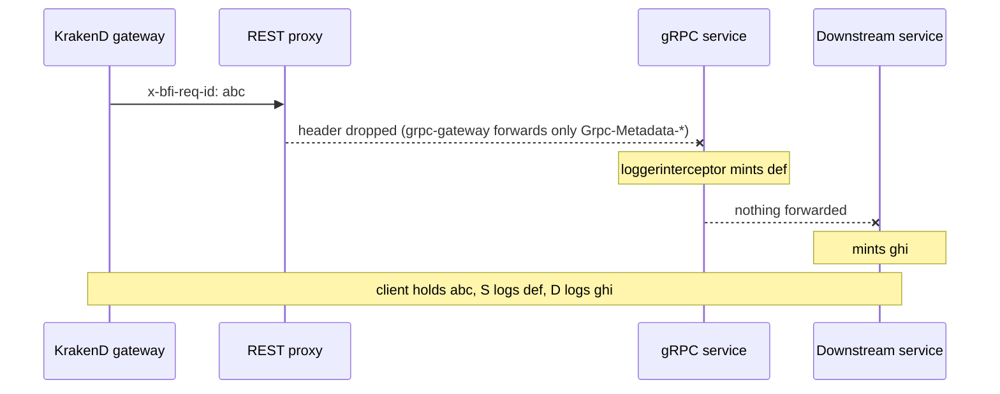
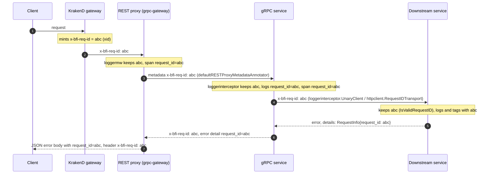
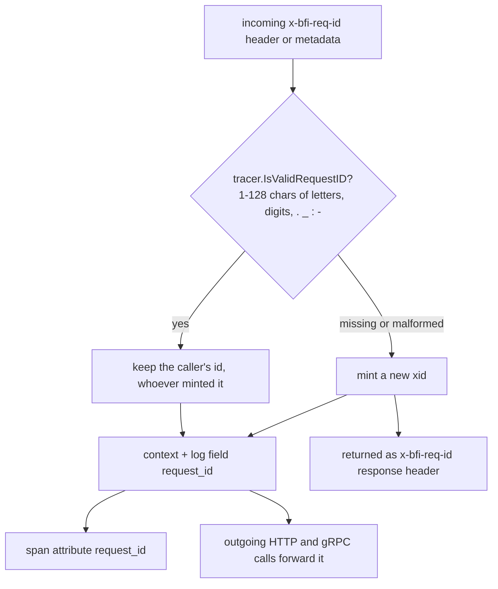
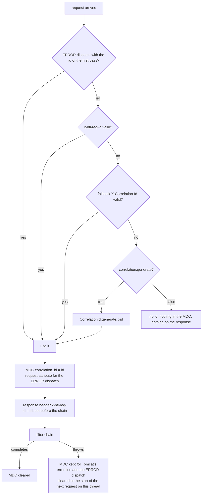
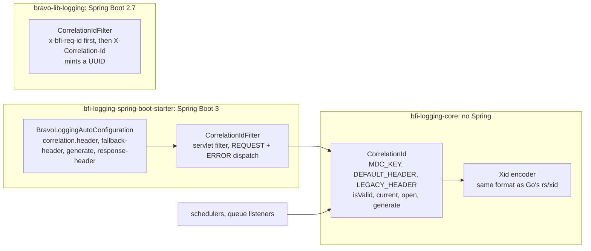
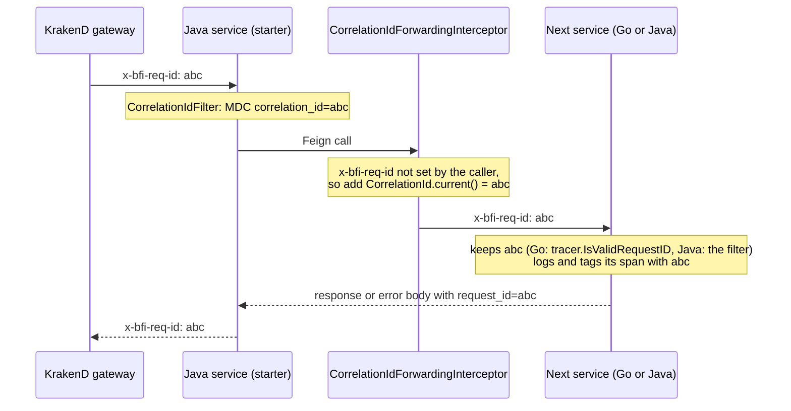
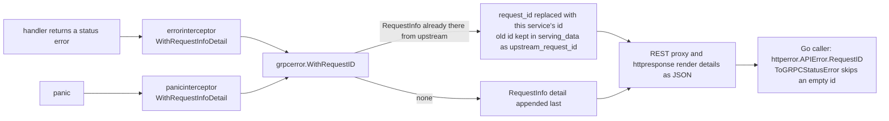
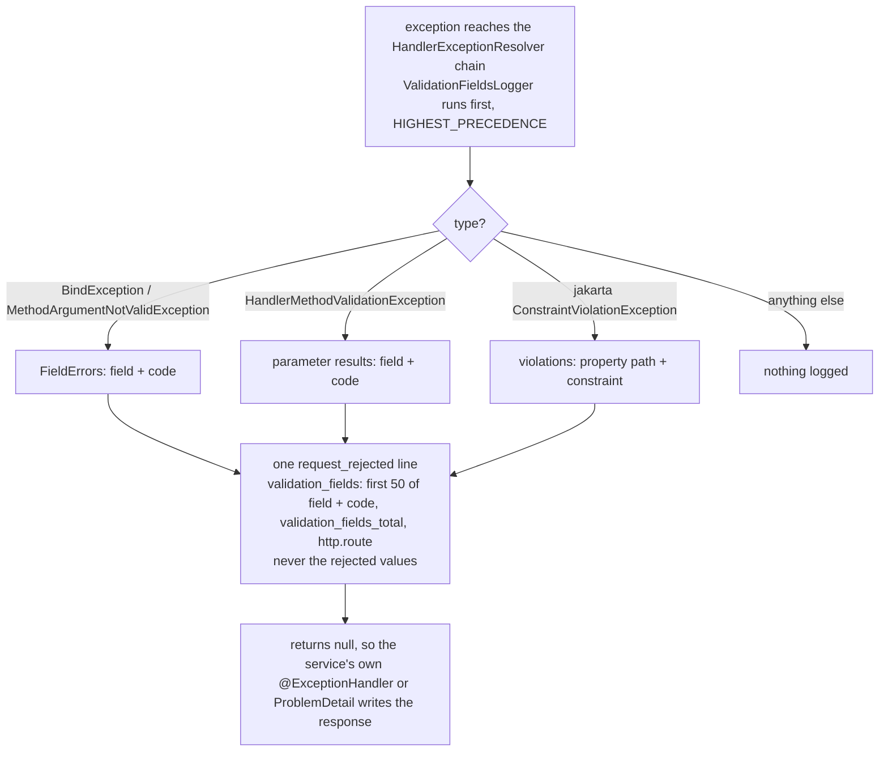
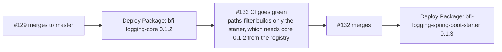

# Logging analysis

## Problem statement

BFI pays too much for its logs, and the logs still do not do their job.

- **We pay too much.** Logging costs about Rp 636M a month across three platforms: Cloud Logging, Coralogix and Datadog. In September the non-production environments spent more on Cloud Logging (Rp 157.5M) than production did (Rp 147.6M), and they serve no customer. Every production service line is also stored twice, because two log collectors run side by side. Our Datadog contract covers 256 GB of log ingestion a month. We send about 1.3 TB a day, so almost all of it is billed as overage. Since 8 October we know that 89% of those bytes are NUL padding from a log-file bug, not logs ([details](#datadog-log-cost-by-service-8-october-2026)).
- **The logs are hard to use.** 93.6% of production log lines cannot be parsed, because the container runtime splits any line over 16 KB. Eleven busy services send no logs to Datadog, and six send neither logs nor traces. Eight services log under two different names, so their logs and traces never join. Some monitors watch service names that do not exist, so they can never fire.
- **Sensitive data is in the logs.** One service wrote a live API secret into production logs for weeks. Working Google Chat webhook credentials, whole HR records and unmasked request and response bodies sit in the Datadog log index.
- **Why it keeps happening.** Squads cannot see request and response bodies in Datadog, so they log full bodies at `info` to answer customer questions. The shared logging libraries make body logging easy and masking weak. Each service sets its own log level and mask list in its deployment settings, and many are left at `debug` or with an empty mask list.

**What this programme does about it.** Send less, mask what we keep, and give squads a supported way to see the data they need. Only then turn on more Datadog features, because Datadog bills on what we send. The ordered work is in [Do these first](#do-these-first).

## Where things stand on 12 October 2026

The steps were checked on 7 October. Pull request states were refreshed on 12 October.

- **One of fourteen steps is done.** Five are partly done or unclear, and eight show no progress. The table below has the status of each.
- **The production manifest change is live.** [app-deployment#13820](https://github.com/bfi-finance/app-deployment/pull/13820) merged on 7 October and rolled out within minutes. It takes nine services off `debug` and gives five of them a mask list. Its effect on volume can be measured from 8 October.
- **Two security items are still open.** The Google Chat webhook keys are still being logged, between 250 and 950 lines on most days. The leaked API secret no longer reaches the logs, but nobody has confirmed it was rotated.
- **Every open step has an SRE ticket and, where a change can fix it, a pull request.** Tickets [SRE-1821](https://bfifinance.atlassian.net/browse/SRE-1821) to [SRE-1832](https://bfifinance.atlassian.net/browse/SRE-1832) carry the label `logging-programme`.
- **Service pull requests: 31 merged, 37 open, 19 closed.** Twenty-four merged on 8 and 9 October, each after a squad approval: eleven from the earlier packs (`bravo-agency-service#1173`, `bravo-auth-service#258`, `bravo-bpm-service#10463` and `#10571`, `bravo-branch-service#506`, `bravo-cnv-service#726`, `bravo-employee-service#172`, `bravo-kyc-sign-service#118`, `bravo-robot-scrape#114`, `bravo-scheduling-service#300`, `doc-renderer-service#31`), `bravo-audit-trail-service#36`, eleven `tee -a` fixes, and the bpm revert `bravo-bpm-service#10578`. That revert undid `#10463` and `#10571` the same morning, so two of the 29 are no longer in effect. Three were closed: the Digital Partnership squad replaced `bravo-partnership-service#2367` with its own #2386, `lora-task-service#1363` was dropped because it relied on debug logging in production, and `bravo-user-iam-service#521` was replaced by the one-flag fix #525. Approved and waiting to merge: `bravo-onboarding-service#6328`, and the three LORA pull requests rebased on 9 October (`lora-gateway-service#1263`, `lora-partnership-ndf#1493`, `lora-partnership-task-ndf#2126`), each with one approval so far. None of the open ones fails CI because of this work. The red checks are gates that were already red before this work. Every pull request and its status is in the [table below](#per-service-pages-and-pull-requests).
- **The bpm logging changes were reverted.** [bravo-bpm-service#10571](https://github.com/bfi-finance/bravo-bpm-service/pull/10571) (the Java logging starter) and [bravo-bpm-service#10463](https://github.com/bfi-finance/bravo-bpm-service/pull/10463) (masked and capped Feign bodies) merged on 9 October. The Scoring and Underwriting squad reverted both the same morning in [bravo-bpm-service#10578](https://github.com/bfi-finance/bravo-bpm-service/pull/10578). They were not ready: one team member approved both, but the squad leads, Anton and Yosef, had not finished reviewing and testing them. Both go back through review before they merge again. The revert brings back complete, unmasked Feign bodies at `info` with no size cap. No service uses the starter on its main branch now. The Go wrapper fix [bfi-go-pkg#175](https://github.com/bfi-finance/bfi-go-pkg/pull/175) merged on 8 October and stays.
- **New on 8 October: 89% of our Datadog log bytes are padding, not logs.** A log-file bug makes 20 services send gaps of NUL bytes to Datadog. It costs about **$4,400 a month (Rp 70M)**. Nineteen pull requests fix it with one flag each. Eleven merged on 9 October, but none was released by 12 October, so Datadog shows no change so far. See [Datadog log cost by service](#datadog-log-cost-by-service-8-october-2026).

## Do these first

| # | Action | Owner | Status (7 Oct; pull requests 12 Oct) | PR and ticket |
|---|---|---|---|---|
| 1 | Fix the leaked API secret in `lms-calculation-service`, and rotate it | Contract Collateral | **Partly done.** The code fix is live since 1 October, and no log line has carried the secret since. Rotation is not confirmed. | [lms-calculation-service#647](https://github.com/bfi-finance/lms-calculation-service/pull/647) (merged); [SRE-1822](https://bfifinance.atlassian.net/browse/SRE-1822) |
| 2 | Merge the production manifest change: log levels and mask lists for 20 services | SRE + squads | **Done.** Merged and rolled out on 7 October. | [app-deployment#13820](https://github.com/bfi-finance/app-deployment/pull/13820) |
| 2a | Adopt the Java logging starter, `bravo-bpm-service` first | Platform + Scoring and Underwriting | **Not done.** `bravo-bpm-service` adopted it on 9 October, and the squad reverted it the same morning, because the squad leads had not finished reviewing and testing it. No service uses the starter on its main branch. | [bravo-bpm-service#10571](https://github.com/bfi-finance/bravo-bpm-service/pull/10571) (merged, then reverted); [bravo-bpm-service#10578](https://github.com/bfi-finance/bravo-bpm-service/pull/10578) (the revert); [SRE-1832](https://bfifinance.atlassian.net/browse/SRE-1832) |
| 3 | Non-production: lower Argo CD's log level, stop the SIT agency–onboarding message loop, add exclusion filters | Platform + Agency | **Partly done.** The fix for the SIT loop, #1173, merged on 9 October. On 7 October Argo CD still wrote about 355 GB a day, and there were still no exclusion filters. | [bravo-terraform#367](https://github.com/bfi-finance/bravo-terraform/pull/367); [bravo-agency-service#1173](https://github.com/bfi-finance/bravo-agency-service/pull/1173) (merged); [SRE-1823](https://bfifinance.atlassian.net/browse/SRE-1823) |
| 4 | Remove the monitors that watch service names that do not exist | SRE | **Not done.** All 74 are still in place and can never fire. | [bravo-terraform#366](https://github.com/bfi-finance/bravo-terraform/pull/366); [SRE-1824](https://bfifinance.atlassian.net/browse/SRE-1824) |
| 5 | Fix CONFINS log re-ingestion | SRE | **Unclear.** The re-reading looks stopped, but volume is 2.7 to 7.3 million entries a day, against about 200,000 in September. | No PR; [SRE-1825](https://bfifinance.atlassian.net/browse/SRE-1825) |
| 6 | Decide what Coralogix is for | Architecture | **No progress.** No page or ticket answers it. | No PR; [SRE-1826](https://bfifinance.atlassian.net/browse/SRE-1826) |
| 7 | Fix Datadog Remote Configuration on 13 services | SRE | **Not done.** 108,000 failed polls in seven days. | No PR; [SRE-1827](https://bfifinance.atlassian.net/browse/SRE-1827) |
| 8 | Tag traces with the request id | Platform | **Not done; approach settled on 12 October.** The manifest setting `DD_TRACE_HEADER_TAGS` cannot work for Go: 20 of the 21 Go services trace with the OpenTelemetry SDK, which ignores it, so #14252 was closed. bfi-go-pkg#185 sets the request id on the span as `request_id` in code. Java services run the Datadog agent, so for them the manifest setting does work, as `x-bfi-req-id:request_id`. See [One request id across services](#one-request-id-across-services-x-bfi-req-id). | [bfi-go-pkg#185](https://github.com/bfi-finance/bfi-go-pkg/pull/185); [app-deployment#14252](https://github.com/bfi-finance/app-deployment/pull/14252) (closed); [SRE-1828](https://bfifinance.atlassian.net/browse/SRE-1828) |
| 9 | Stop logging the Google Chat webhook keys in `bau-prod-ms-otrs-report`, then rotate them | Platform / security | **Not done.** 954 lines carried the keys on 6 October. | No PR, no write access; [SRE-1821](https://bfifinance.atlassian.net/browse/SRE-1821) |
| 10 | Fix the three CI gate faults: Codacy token, Codacy installer, SonarQube baseline | Platform | **Not done.** A shallow clone is ruled out as the SonarQube cause. The baseline is the next suspect. | No PR; [SRE-1829](https://bfifinance.atlassian.net/browse/SRE-1829) |
| 11 | Return the request id to the caller and log one line per rejected request, in the shared libraries | Platform, then squads | **In review.** Both wrappers now do it, and on 12 October the three pull requests were widened so that one id, the gateway's `x-bfi-req-id`, survives every hop (see [One request id across services](#one-request-id-across-services-x-bfi-req-id)). Nothing is merged yet. | [bfi-go-pkg#185](https://github.com/bfi-finance/bfi-go-pkg/pull/185); [bfi-java-pkg#129](https://github.com/bfi-finance/bfi-java-pkg/pull/129); [bfi-java-pkg#132](https://github.com/bfi-finance/bfi-java-pkg/pull/132); [SRE-1830](https://bfifinance.atlassian.net/browse/SRE-1830) |
| 12 | Apply the SIT and UAT logging baseline to 29 manifest files | SRE | **Partly done.** The 29-file baseline, #14251, merged on 12 October. Its effect on SIT and UAT log volume has not been measured yet. | [app-deployment#14251](https://github.com/bfi-finance/app-deployment/pull/14251) (merged); [SRE-1831](https://bfifinance.atlassian.net/browse/SRE-1831) |
| 13 | Stop sending NUL padding to Datadog: `tee -a` in 20 service entrypoints, then fix the log-file setup on the nodes | Squads, then SRE | **Partly done.** 11 of 19 pull requests merged on 9 October: rule-engine, audit-trail, cnv, gen-ai, scheduling, partnership, user-iam, integrity, robot-controller, customer-bff and kyc-proxy. None was released by 12 October, so Datadog shows no effect so far. One repository is archived. | 19 pull requests in the [table below](#per-service-pages-and-pull-requests); details in [Datadog log cost by service](#datadog-log-cost-by-service-8-october-2026) |

None of these steps increases Datadog spend. Take the two security items, 9 and 1, first. Step 13 saves the most money. The evidence behind each status is on [the history page](history.md#do-these-first--full-evidence).

## One request id across services (`x-bfi-req-id`)

**Decided 12 October 2026.** Every request carries one id, in the `x-bfi-req-id` header, from the client through every service it touches. The API gateway (`bravo-krakend-gateway`) already mints that id for every request, sends it to the backend and returns it to the client. The job is to stop losing it on the way down, so that the id a client or support quotes finds the logs and the trace of every service involved.

### What was broken

The two wrapper pull requests, bfi-go-pkg#185 and bfi-java-pkg#129, were right inside the libraries, but a check against how the services are wired on 12 October found four places where the id was lost:

| Where | What happened | How many services |
|---|---|---|
| Go, REST proxy | grpc-gateway forwards only a few standard headers. No service whitelists `x-bfi-req-id`, so the proxy dropped it and the gRPC side minted a second id. The id the client holds was not the id in the logs. | 28 gRPC-first Go services |
| Go, outgoing calls | The wrapper's HTTP and gRPC clients did not forward the id. Three services did it by hand. Every Go→Go and Go→Java hop started a new id. | about 50 Go services |
| Go, incoming id | The wrapper accepted an xid only, so an id minted by a Java service was replaced. | all Go services |
| Java | The starter read `X-Correlation-Id`; the gateway sends `x-bfi-req-id`. No Java repository knows that name. And the starter minted nothing when the header was missing, so most Java requests had no id at all to log, forward or quote. | all 34 Java services |

#### In pictures

**Before: where the id was lost between the gateway and a gRPC service, and on every outgoing call.**

<!-- confluence-image: reqid-go-before.png -->

**After: one id from the client to the downstream service and back, in logs, on spans and in the error body.**

<!-- confluence-image: reqid-go-after.png -->

**The rule every Go service applies to an incoming id after the bump (bfi-go-pkg#185).**

<!-- confluence-image: reqid-go-inbound-rule.png -->

**The rule the Java starter applies (bfi-java-pkg#129): gateway header first, old header second, then a minted xid.**

<!-- confluence-image: reqid-java-filter.png -->

**Where the Java pieces live: framework-free rules in core, the servlet filter in the starter, the old library for Boot 2.7.**

<!-- confluence-image: reqid-java-modules.png -->

**A Feign call carries the id into the next service, Go or Java (bfi-java-pkg#132).**

<!-- confluence-image: reqid-java-feign.png -->

**The opt-in error-body detail in Go: how an upstream id is kept and how a client reads it back.**

<!-- confluence-image: reqid-go-error-body.png -->

**One `request_rejected` line per failed validation in Java, with field names and codes but never the values.**

<!-- confluence-image: reqid-java-validation-line.png -->

**Release order for the Java pull requests, and why #132's CI stays red until core 0.1.2 is published.**

<!-- confluence-image: reqid-java-merge-order.png -->

### What fixes it, and where

| Pull request | What it now does | Status (12 Oct) |
|---|---|---|
| [bfi-go-pkg#185](https://github.com/bfi-finance/bfi-go-pkg/pull/185) | REST proxy forwards the id into gRPC metadata by default. `httpclient.New` and `LoggedTransport` forward it on outgoing HTTP. `loggerinterceptor.UnaryClient()` forwards it on gRPC dials. Incoming ids are kept when well formed (letters, digits, `. _ : -`, up to 128). Both inbound paths tag the span with `request_id`. Error bodies carry the id when a service opts in. | open, CI green, waiting for review |
| [bfi-java-pkg#129](https://github.com/bfi-finance/bfi-java-pkg/pull/129) | Starter reads `x-bfi-req-id` first, `X-Correlation-Id` as a fallback. Mints an id when none arrives, in the same xid format as the gateway, so older Go services keep it. Returns it on the response. The old `bravo-lib-logging` reads `x-bfi-req-id` first too. | open, waiting for review |
| [bfi-java-pkg#132](https://github.com/bfi-finance/bfi-java-pkg/pull/132) | Forwards the id on every Feign call. Logs one `request_rejected` line with the failed field names, never the values. Opt-in id on `ProblemDetail` error bodies. | open; CI red until core 0.1.2 is published after #129 merges |

### What each team does once the libraries are released

| Team | What to do |
|---|---|
| Go squads, HTTP services (17) | Bump bfi-go-pkg. Nothing else for logs, spans and outgoing HTTP. gRPC dials get one line: `grpc.WithChainUnaryInterceptor(loggerinterceptor.UnaryClient())`. Error bodies: use `httpresponse.ErrorAsJSONForRequest(w, r, err)`. |
| Go squads, gRPC services (28) | Bump bfi-go-pkg. The proxy fix needs no service change. Error bodies: opt in with `WithRequestInfoDetail()` on `errorinterceptor` and `panicinterceptor`, after checking that callers do not reject an unknown `@type`. |
| Java squads on Spring Boot 3 (20) | Adopt the starter (0.1.3 or later). Feign calls forward the id with no code. RestTemplate and WebClient calls need the service's own interceptor. Services that handle `X-Correlation-Id` themselves switch to `x-bfi-req-id`. |
| Java squads on Spring Boot 2.7 (14) | The starter needs Boot 3. The old library reads the gateway's id after the next `bravo-lib-logging` release. Forwarding on Feign needs the service's own interceptor. |
| SRE | Java services only: set `DD_TRACE_HEADER_TAGS: "x-bfi-req-id:request_id"` in each service's app-deployment values. The Datadog Java agent then tags spans with the same name the Go wrapper uses. Go services ignore the setting. |
| Platform | Merge order: #185; #129, then publish core 0.1.2 at once; then #132. Cut a `bravo-lib-logging` release from the `logger` module. |

### How to use it

- **Find everything about one request in Datadog.** Logs: `@request_id:<id> OR @correlation_id:<id>` (Go logs the field as `request_id`, Java as `correlation_id`). Traces: `@request_id:<id>`, once services are on the new libraries and Java manifests carry the setting above.
- **Support asks a caller for the id.** It is the `x-bfi-req-id` response header, and in the error body where a service opted in.
- **Background work** (schedulers, queue consumers) has no incoming id. Go leaves it empty. Java opens one with `CorrelationId.open(CorrelationId.generate())`.

The Mermaid sources of the pictures are in [docs/logging/diagrams](diagrams/). The survey behind the numbers above is on [the history page](history.md#one-request-id-across-services--the-survey-of-12-october).

## Datadog log cost by service (8 October 2026)

Measured from Datadog's own usage metrics (`datadog.estimated_usage.logs.*`) for the 30 days to 8 October 2026. Priced at our contract's overage rates: $0.10 per GB ingested and about $1.45 per million indexed lines. Almost everything is overage, because the contract covers only 256 GB and 150 million lines a month. Rupiah at Rp 16,000 to the dollar.

**The short version**

- Datadog logs cost us about **$5,300 a month (Rp 85M)**. Ingested bytes make up about $4,900 of that, and indexed lines the rest.
- **About $4,400 a month of it is padding, not logs.** Twenty services send gaps of NUL bytes to Datadog because of a one-flag bug in how they write their log file.
- `core-system-prod` (CONFINS) sends 71% of our log *lines* but only 2% of the bytes. It costs about **$300 a month (Rp 4.8M)**.

**By index**

| Index | Lines ingested | Lines indexed (billed) | Bytes ingested | Cost a month |
|---|---:|---:|---:|---:|
| `prod-bravo-cluster` | 103M | 103M | 47,982 GB (97%) | ~$4,950 (Rp 79M) |
| `core-system-prod` | 287M (72%) | 144M | 881 GB (2%) | ~$300 (Rp 4.8M) |
| `bfi-project-prod` | 10M | 10M | 429 GB | ~$60 |
| others | 2M | 0.3M | 3 GB | — |

Half of the `core-system-prod` lines are already dropped by an exclusion filter before indexing. Its two big senders are `confins-prod-ms-lms-ar-be` ($170 a month) and `confins-prod-ms-foundation-be` ($91), the two services with the file re-reading problem in step 5.

**`prod-bravo-cluster` by service**

| Service | Ingested | Lines indexed | Cost a month | Share | Fix |
|---|---:|---:|---:|---:|---|
| prod-ms-audit-trail | 10,679 GB | 7.0M | $1,078 (Rp 17.2M) | 21.8% | `tee -a` |
| prod-ms-lms-ops | 6,879 GB | 5.7M | $696 (Rp 11.1M) | 14.1% | `tee -a` |
| prod-ms-cnv | 4,527 GB | 11.0M | $469 (Rp 7.5M) | 9.5% | `tee -a` |
| prod-ms-assistance | 4,149 GB | 3.8M | $420 (Rp 6.7M) | 8.5% | `tee -a` |
| prod-ms-user-iam | 2,842 GB | 1.9M | $287 (Rp 4.6M) | 5.8% | `tee -a` |
| prod-ms-supplier | 2,637 GB | 1.7M | $266 (Rp 4.3M) | 5.4% | `tee -a` |
| prod-ms-repeat-order | 2,458 GB | 2.2M | $249 (Rp 4.0M) | 5.0% | already fixed on master, waits for a release |
| prod-agent-marketing | 2,253 GB | 1.9M | $228 (Rp 3.6M) | 4.6% | `tee -a` |
| prod-customer-bff | 1,915 GB | 2.5M | $195 (Rp 3.1M) | 3.9% | `tee -a` |
| prod-ms-collection-consumer | 1,509 GB | 3.7M | $156 (Rp 2.5M) | 3.2% | `tee -a` |
| prod-sharia-user-iam-sharia | 1,379 GB | 0.9M | $139 (Rp 2.2M) | 2.8% | `tee -a` (same repository as user-iam) |
| prod-ms-rule-engine | 1,263 GB | 0.8M | $127 (Rp 2.0M) | 2.6% | `tee -a` |
| prod-ms-scheduling | 1,010 GB | 0.8M | $102 (Rp 1.6M) | 2.1% | `tee -a` |
| prod-ms-bpm | 782 GB | 5.1M | $86 (Rp 1.4M) | 1.7% | real Feign bodies, see bpm pull requests |
| prod-ms-agency | 816 GB | 0.7M | $83 (Rp 1.3M) | 1.7% | `tee -a` |
| prod-inventory-management | 627 GB | 2.3M | $66 (Rp 1.1M) | 1.3% | not yet explained |
| prod-ms-gen-ai | 570 GB | 0.4M | $58 (Rp 0.9M) | 1.2% | `tee -a` |
| about 45 other services | ~1,690 GB | ~51M | ~$245 (Rp 3.9M) | ~4.9% | `tee -a` where the repository has it |
| **Total** | **47,982 GB** | **103M** | **~$4,950 (Rp 79M)** | | |

`prod-lora-task` sends the most lines in this index (17M), but its lines are small, so it costs only $28 a month.

### Why the bytes are so high: NUL padding

Most of these services send lines that weigh **1 to 1.5 MB each** on average. A real log line weighs 1 to 3 KB. This is the cause:

1. The service's `docker-entrypoint.sh` runs `$SERVICE_EXECUTABLE 2>&1 | tee /tmp/log/<pod>.json`. `/tmp/log` is a hostPath on the node, and the Datadog Agent reads `*.json` and `*.log` files there (`bravo-terraform`, `product/helm-apps/datadog.yaml`).
2. Every night at 19:00 UTC, four cron jobs in `bravo-terraform` (`product/helm-apps/datadog.tf`, `clear-log-*`) empty those files with `echo "" | tee /var/log/*.json`.
3. `tee` without `-a` keeps writing at its old position. When a shell script truncates a file (e.g., `> file` or `echo "" | tee file`), it sets the file size to 0 bytes. However, the application process (`tee` or the running service) still holds an open file descriptor with its internal file offset pointer sitting at, say, byte position `100,000,000`.

   When `tee` writes its next line, the operating system writes those bytes starting at offset `100,000,001`. The OS automatically fills the unwritten space between byte `0` and byte `100,000,000` with sparse **NUL bytes** (`\x00`), creating a sparse file containing a massive hole. The file now starts with a gap of NUL bytes, as big as everything the service logged before the cron ran.
4. Datadog tracks its position in log files using the file size and offset pointers (or inodes). When the agent detects that the file size suddenly reset to 0, it treats the file as truncated or re-created, resetting its offset back to 0.

   As the application writes its next log entry at offset $N$, the file size immediately jumps back up to $N + \text{bytes}$. The Agent attempts to read from byte 0 to offset $N$, encounters megabytes (or gigabytes) of `\x00` characters, breaks them up into default chunk sizes (such as 256 KB), and attempts to ship them downstream. Each chunk is billed at about 1.5 MB.

What we saw in Datadog:

- In `prod-ms-audit-trail` over 24 hours, 18,476 of 19,329 lines were chunks that start with `...TRUNCATED...` and contain only unreadable characters. The other 853 were real errors of 90 characters each.
- In a 2-hour sample across production, padding chunks were 95 to 100% of the `info` lines of `lms-ops`, `customer-bff`, `cnv`, `agent-marketing`, `supplier`, `collection-consumer`, `scheduling`, `kyc-proxy`, `user-iam` and others.
- One padding line was 154 MB when fetched through the Datadog API, too large for the API to return.
- I reproduced the mechanism on a laptop: a writer piped through plain `tee` while the file was emptied mid-run left 2,679 NUL bytes at the start of the file. `tee -a` left none, and both kept every real line.

This also explains the old puzzle in [logging-cost.md](logging-cost.md) §1a: "40 TB across 240M events is 166 KB per event". Real lines are small, and the padding chunks are huge.

### Recommendations

1. **Squads: merge the 19 `tee -a` pull requests and release.** Each one changes one flag in `docker-entrypoint.sh`. Expected saving: **about $4,400 a month (Rp 70M), about Rp 845M a year**. This is 89% of our Datadog log bytes. Check after the release: `"...TRUNCATED..."` lines for the service drop to almost none after the next 19:00 UTC run.
2. **SRE, now, without waiting for squads:** add an Agent processing rule that drops lines made only of NUL bytes. One global rule in the Agent configuration covers every service at once. Test it on one node pool first.
3. **SRE: fix the weekly delete jobs.** `find /var/log/*.json -size -2k -exec rm` runs on Sundays and deletes any file under 2 KB. Right after the nightly truncation, a quiet service's live file is that small. It gets deleted while `tee` still writes to it, so that service's logs stop reaching Datadog until the pod restarts. Only delete files that have not changed for two days (`-mmin +2880`).
4. **SRE, later: stop writing log files on the node.** Read container stdout instead (Agent container log collection), then remove the `tee`, the hostPath and the cron jobs. That removes this whole class of bug, including the CONFINS re-reading in step 5.
5. **`prod-ms-unsecured-v2` runs from an archived repository** (`bravo-unsecuredv2-service`, archived 25 June 2026, prod still on v1.8.1). Nobody can change its code. It costs $28 a month. Its owner should either retire the service or unarchive the repository.
6. **`prod-ms-repeat-order` needs no pull request.** Master stopped using `tee` on 1 October (logback writes the file in append mode). Production still runs v3.52.2, which has the bug. The next release fixes it.

### Has the fix helped yet? (checked 9 October; updated 12 October)

**Update, 12 October: eleven merged, still none released.** `bravo-customer-bff-service#1297` and `bravo-kyc-proxy#740` also merged on 9 October. Between 8 and 12 October every one of these services kept the version it had before its merge (customer-bff v1.26.0, kyc-proxy v1.46.0). **Earlier update, 9 October 08:55 UTC: nine merged, still none released.** Four more merged after the first check: `bravo-partnership-service#2400`, `bravo-user-iam-service#525`, `bravo-integrity-service#30` and `bravo-robot-controller#92`. Production still runs the pre-merge version of all nine services: partnership v3.7.1, user-iam v1.0.16, integrity v1.1.4, robot-controller v1.3.4, and the five below unchanged.

**Not yet, and it cannot have.** Five `tee -a` pull requests merged on 9 October between 04:25 and 04:35 UTC. Production still runs the versions from before the merge, and no release tag contains it yet. The fix also only shows after the first 19:00 UTC truncation following a release.

| Service | Pull request | Production version on 9 Oct | Release with the fix | Padding lines a day, 2–8 Oct | Log GB a day, 2–8 Oct | Monthly cost (30 days to 8 Oct) |
|---|---|---|---|---:|---:|---:|
| prod-ms-audit-trail | [#38](https://github.com/bfi-finance/bravo-audit-trail-service/pull/38) | v1.1.11 | not yet | 83,900 | 145 | $1,078 |
| prod-ms-cnv | [#777](https://github.com/bfi-finance/bravo-cnv-service/pull/777) | v1.65.1 | not yet | 63,100 | 98 | $469 |
| prod-ms-rule-engine | [#84](https://github.com/bfi-finance/bfi-rule-engine-service/pull/84) | v1.1.0 | not yet | 11,000 | 17 | $127 |
| prod-ms-scheduling | [#305](https://github.com/bfi-finance/bravo-scheduling-service/pull/305) | v2.2.18 | not yet | 4,500 | 7 | $102 |
| prod-ms-gen-ai | [#362](https://github.com/bfi-finance/bravo-gen-ai/pull/362) | v1.4.18 | not yet | 4,200 | 8 | $58 |

Together these five carry about **$1,830 a month (Rp 29M)**, about 42% of the saving step 13 targets. Padding lines are the indexed lines that start with `...TRUNCATED...`. The daily numbers swing a lot, so judge the fix on a week, not a day.

**How to check after each release.** Wait for the first 19:00 UTC run after the new version is live. From the next day, the service's `...TRUNCATED...` lines should be close to zero, and its log GB a day should fall to its real log volume, a few GB at most. If the padding lines do not drop, check that the running image is the new tag and that the entrypoint has `tee -a`.

**When to check.** A merge changes nothing in Datadog until the squad releases it. Then the nightly truncation at 19:00 UTC (02:00 WIB) has to run once on the new version. So for each service:

1. Watch for the new version in production. The `version` tag on the service's logs changes.
2. Check the first full UTC day after the next 19:00 UTC run. If a release goes live on Monday daytime WIB, check on Wednesday morning WIB, which covers all of Tuesday UTC.
3. Judge the saving over 7 days after the release, because daily volume swings a lot.

How often these services release, from their tags:

| Service | Recent releases | Likely first check |
|---|---|---|
| cnv | five between 29 Sep and 5 Oct | within a week |
| partnership | 17, 22 and 24 Sep, 6 Oct | within one to two weeks |
| scheduling | 3, 17 and 21 Sep | within two weeks |
| rule-engine | 20 Aug, 1 Oct | only when the squad cuts a release |
| user-iam | 1 Jul, 24 Sep | only when the squad cuts a release |
| audit-trail | 18 Dec 2025, 31 Jul 2026 | only when the squad cuts a release |
| integrity | Nov 2025, 20 Aug 2026 | only when the squad cuts a release |
| robot-controller | 28 Jul, 4 Aug | only when the squad cuts a release |
| gen-ai | v1.4.19 tagged 13 Aug but never deployed; production runs v1.4.18 | only when the squad cuts a release |

The biggest saving, `audit-trail` at about $1,078 a month, sits in a service that released twice in ten months. **Ask the Internal Service squad to cut releases for `audit-trail`, `user-iam`, `integrity`, `robot-controller` and `gen-ai` now, and the Digital Partnership squad for `rule-engine`.** Waiting for their next feature release could take months.

**What it does to the contract.** Without the padding, we would send about 5 TB a month instead of 49 TB. That is still above the 256 GB commitment, so log ingestion would cost about $500 a month instead of $4,900. At renewal, size the log line to about 6 TB a month, not 256 GB, and move money from the unused span and host lines.

**How this was measured.** Bytes and lines per service come from `datadog.estimated_usage.logs.ingested_bytes` and `ingested_events`, grouped by `datadog_index`, `datadog_is_excluded` and `service`. Padding was found with Log Analytics (DDSQL) over the message length and the `...TRUNCATED...` marker. Datadog's own Usage & Cost page and the invoice remain the final word. SRE should check the October invoice against these figures.

## Moving to Datadog

BFI is standardising on Datadog for logs, traces and metrics. Clean up first, then turn on more Datadog features. Datadog bills on what we send it, so turning features on against today's stream would move the waste from Cloud Logging to Datadog and cost more.

SRE turns features on when both numbers below reach their gate:

| Metric | Today | Gate |
|---|---:|---:|
| Production log lines per day | ~4.5M | **below 2.5M** |
| Share Datadog can parse | 6.4% | **above 80%** |

The one exception is Error Tracking. It uses telemetry that already flows and adds no ingestion, so turn it on now.

Our Datadog contract commits 256 GB of log ingestion a month. We send about 40 TB a month, 150 times that, and the excess is billed as overage. The detail is in [logging-cost.md](logging-cost.md) §1a.

## Documents

| Document | What it is for |
|---|---|
| [logging-cost.md](logging-cost.md) | What logging costs, where the money goes, and the ordered work list |
| [bravo-logging-deck.html](../decks/bravo-logging-deck.html) ([PDF](../decks/pdf/bravo-logging-deck.pdf)) | The CTO deck, 13 slides |
| [squads-guide.md](squads-guide.md) | For every squad: what to log, what not to log, and which Datadog feature answers which question |
| [sre-datadog-recommendations.md](sre-datadog-recommendations.md) | For SRE: an audit of our Datadog setup and what to change |
| [body-visibility.md](body-visibility.md) | Why squads log request and response bodies, and what replaces that |
| [nonprod-logging.md](nonprod-logging.md) | SIT and UAT: what they cost and the logging baseline |
| [deployment-proposal.md](deployment-proposal.md) | The production manifest changes and the reasoning behind them |
| [coverage.md](coverage.md) | The estate map: 122 production services, 52 with no source we can see |
| [confins-prod-ms-lms-ar-be-findings.md](confins-prod-ms-lms-ar-be-findings.md) | The CONFINS log re-ingestion finding |
| [history.md](history.md) | Full evidence, weekly changes, every pull request with its status, and CI results |

## Per-service pages and pull requests

Every service in the programme has its own page with its findings and what its squad should do. The table lists each service's pull request and its status on 12 October. Squads come from the squad-to-repository sheet; a star marks a repository that is not in the sheet, where the squad is inferred from the squad's system list. Pull request counts for services on 12 October: 31 merged, 37 open, 19 closed. Two of the 31 were reverted by the bpm squad. The 37 open include 8 of the 19 `tee -a` pull requests raised on 8 October.

| Service | Squad | Pull request | What it fixes | Status (12 Oct) |
|---|---|---|---|---|
| [backend-dashboard-otrs](backend-dashboard-otrs.md) | — | none | No write access | no pull request |
| [bfi-connect](bfi-connect.md) | — | [#788](https://github.com/bfi-finance/bfi-connect/pull/788) | stop logging customer phone numbers on every duplicate-check miss | open — red only on Prettier |
| [bfi-digital-web-api](bfi-digital-web-api.md) | Digital Web | [#711](https://github.com/bfi-finance/bfi-digital-web-api/pull/711) | 679 `console.log` in a Node backend — billable | open — red only on SNYK / image CVEs |
| [bfi-incentive-api](bfi-incentive-api.md) | Agency | [#1698](https://github.com/bfi-finance/bfi-incentive-api/pull/1698) | give the consumer failure a stable message | open — red only on SNYK / image CVEs |
| [bfi-insurance-api](bfi-insurance-api.md) | Insurance | [#3298](https://github.com/bfi-finance/bfi-insurance-api/pull/3298) | 624 exception logs, broker body logging, logs in loops | open — red only on SNYK / image CVEs, SonarQube |
| [bfi-operation-api](bfi-operation-api.md) | — | none | No write access | no pull request |
| [bfi-payment-api](bfi-payment-api.md) | Payment | [#1650](https://github.com/bfi-finance/bfi-payment-api/pull/1650) | Dev profile debug levels and Feign full | **merged 7 Oct** |
| [bfi-rule-engine-service](bfi-rule-engine-service.md) | Digital Partnership | [#67](https://github.com/bfi-finance/bfi-rule-engine-service/pull/67) | mask outbound HTTP bodies before they reach the log stream | **merged 17 Sep** |
| [bfi-rule-engine-service](bfi-rule-engine-service.md) | Digital Partnership | [#84](https://github.com/bfi-finance/bfi-rule-engine-service/pull/84) | stop sending NUL padding to Datadog: `tee -a` in the entrypoint | **merged 9 Oct** |
| [bravo-agency-service](bravo-agency-service.md) | Agency | [#1141](https://github.com/bfi-finance/bravo-agency-service/pull/1141) | Payload filter defaulting to DEBUG | **merged 18 Sep** |
| [bravo-agency-service](bravo-agency-service.md) | Agency | [#1173](https://github.com/bfi-finance/bravo-agency-service/pull/1173) | stop the SIT message loop: reject without requeue when the application does not exist | **merged 9 Oct** |
| [bravo-agency-service](bravo-agency-service.md) | Agency | [#1175](https://github.com/bfi-finance/bravo-agency-service/pull/1175) | stop sending NUL padding to Datadog: `tee -a` in the entrypoint | open — CI green |
| [bravo-agent-marketing-service](bravo-agent-marketing-service.md) | Agency | [#829](https://github.com/bfi-finance/bravo-agent-marketing-service/pull/829) | mask request and response bodies by default (closed: masking is a deployment setting, not a code default) | closed 14 Sep |
| [bravo-agent-marketing-service](bravo-agent-marketing-service.md) | Agency | [#840](https://github.com/bfi-finance/bravo-agent-marketing-service/pull/840) | stop sending NUL padding to Datadog: `tee -a` in the entrypoint | open — CI green |
| [bravo-agent-service](bravo-agent-service.md) | Agency | [#1632](https://github.com/bfi-finance/bravo-agent-service/pull/1632) | log rejected requests at warn, not error | open — red only on SonarQube |
| [bravo-agreement-service](bravo-agreement-service.md) | Contract Collateral | [#2604](https://github.com/bfi-finance/bravo-agreement-service/pull/2604) | 209 exception logs, dormant `loggerLevel: full` | open — CI green |
| [bravo-approval-engine-service](bravo-approval-engine-service.md) | Contract Collateral | [#166](https://github.com/bfi-finance/bravo-approval-engine-service/pull/166) | Payload filter defaulting to DEBUG | open — red only on SNYK / image CVEs |
| [bravo-asset-pricing-service](bravo-asset-pricing-service.md) | Internal Service | none | Nothing to change — and no telemetry in production at all | no pull request |
| [bravo-assistance-service](bravo-assistance-service.md) | Customer Platform | [#200](https://github.com/bfi-finance/bravo-assistance-service/pull/200) | mask request and response bodies by default (closed: masking is a deployment setting, not a code default) | closed 14 Sep |
| [bravo-assistance-service](bravo-assistance-service.md) | Customer Platform | [#207](https://github.com/bfi-finance/bravo-assistance-service/pull/207) | stop sending NUL padding to Datadog: `tee -a` in the entrypoint | open — CI green |
| [bravo-audit-trail-service](bravo-audit-trail-service.md) | Internal Service | [#36](https://github.com/bfi-finance/bravo-audit-trail-service/pull/36) | mask outbound bodies, and say what the error was | **merged 9 Oct** |
| [bravo-audit-trail-service](bravo-audit-trail-service.md) | Internal Service | [#38](https://github.com/bfi-finance/bravo-audit-trail-service/pull/38) | stop sending NUL padding to Datadog: `tee -a` in the entrypoint | **merged 9 Oct** |
| [bravo-auth-service](bravo-auth-service.md) | Internal Service | [#258](https://github.com/bfi-finance/bravo-auth-service/pull/258) | pick the log level from the status code | **merged 9 Oct** |
| [bravo-backoffice-service](bravo-backoffice-service.md) | Direct Marketing | [#2781](https://github.com/bfi-finance/bravo-backoffice-service/pull/2781) | mask request and response bodies by default (closed: masking is a deployment setting, not a code default) | closed 14 Sep |
| [bravo-backoffice-service](bravo-backoffice-service.md) | Direct Marketing | [#2982](https://github.com/bfi-finance/bravo-backoffice-service/pull/2982) | stop sending NUL padding to Datadog: `tee -a` in the entrypoint | open — CI green |
| [bravo-bpm-service](bravo-bpm-service.md) | Scoring and Underwriting | [#10463](https://github.com/bfi-finance/bravo-bpm-service/pull/10463) | 384 `loggerLevel: full`, stack frames, ENGINE-09004 | **merged 9 Oct**, reverted the same day in #10578: not finished in review and testing |
| [bravo-bpm-service](bravo-bpm-service.md) | Scoring and Underwriting | [#10571](https://github.com/bfi-finance/bravo-bpm-service/pull/10571) | adopt the Java logging starter 0.1.1 | **merged 9 Oct**, reverted the same day in #10578: not finished in review and testing |
| [bravo-bpm-service](bravo-bpm-service.md) | Scoring and Underwriting | [#10578](https://github.com/bfi-finance/bravo-bpm-service/pull/10578) | the squad's revert of #10463 and #10571: one team member had approved them before the squad leads finished review and testing. Feign bodies are logged in full and unmasked again | **merged 9 Oct** |
| [bravo-branch-service](bravo-branch-service.md) | Internal Service | [#506](https://github.com/bfi-finance/bravo-branch-service/pull/506) | Logs inside branch-sync loops | **merged 9 Oct** |
| [bravo-calculation-service](bravo-calculation-service.md) | — | none | Mis-mapped by me | no pull request |
| [bravo-cnv-service](bravo-cnv-service.md) | Internal Service | [#726](https://github.com/bfi-finance/bravo-cnv-service/pull/726) | 20k failed HCIS messages/day, logged twice each | **merged 9 Oct** |
| [bravo-cnv-service](bravo-cnv-service.md) | Internal Service | [#777](https://github.com/bfi-finance/bravo-cnv-service/pull/777) | stop sending NUL padding to Datadog: `tee -a` in the entrypoint | **merged 9 Oct** |
| [bravo-collateral-service](bravo-collateral-service.md) | Contract Collateral | [#420](https://github.com/bfi-finance/bravo-collateral-service/pull/420) | log rejected requests at warn, and close the payload trap | open — red only on SonarQube |
| [bravo-core-proxy-service](bravo-core-proxy-service.md) | Contract Collateral | [#418](https://github.com/bfi-finance/bravo-core-proxy-service/pull/418) | Payload filter defaulting to DEBUG | open — red only on SonarQube |
| [bravo-customer-app-loan-service](bravo-customer-app-loan-service.md) | — | none | Mis-mapped by me | no pull request |
| [bravo-customer-bff-service](bravo-customer-bff-service.md) | Customer Mobile Apps | [#1216](https://github.com/bfi-finance/bravo-customer-bff-service/pull/1216) | give the masked-field lists a default (closed: masking is a deployment setting, not a code default) | closed 14 Sep |
| [bravo-customer-bff-service](bravo-customer-bff-service.md) | Customer Mobile Apps | [#1297](https://github.com/bfi-finance/bravo-customer-bff-service/pull/1297) | stop sending NUL padding to Datadog: `tee -a` in the entrypoint | **merged 9 Oct** |
| [bravo-customer-service](bravo-customer-service.md) | Contract Collateral | [#621](https://github.com/bfi-finance/bravo-customer-service/pull/621) | 108 exception logs, dormant payload filter | open — CI green |
| [bravo-database-catalog](bravo-database-catalog.md) | — | [#41](https://github.com/bfi-finance/bravo-database-catalog/pull/41) | mask request and response bodies by default | open — CI green |
| [bravo-document-service](bravo-document-service.md) | Operation Post-Go Live | none | Nothing to change — and no telemetry in production at all | no pull request |
| [bravo-edoc-service](bravo-edoc-service.md) | Operation Post-Go Live | [#1525](https://github.com/bfi-finance/bravo-edoc-service/pull/1525) | 175 exception logs, dormant `loggerLevel: full` | **merged 6 Oct** |
| [bravo-employee-service](bravo-employee-service.md) | Internal Service | [#172](https://github.com/bfi-finance/bravo-employee-service/pull/172) | stop writing whole HR records to the log stream | **merged 9 Oct** |
| [bravo-gen-ai](bravo-gen-ai.md) | Internal Service | [#359](https://github.com/bfi-finance/bravo-gen-ai/pull/359) | give the masked-field lists a default (closed: masking is a deployment setting, not a code default) | closed 14 Sep |
| [bravo-gen-ai](bravo-gen-ai.md) | Internal Service | [#362](https://github.com/bfi-finance/bravo-gen-ai/pull/362) | stop sending NUL padding to Datadog: `tee -a` in the entrypoint | **merged 9 Oct** |
| [bravo-insurance-service](bravo-insurance-service.md) | Insurance | [#820](https://github.com/bfi-finance/bravo-insurance-service/pull/820) | log rejected requests at warn, not error | **merged 24 Sep** |
| [bravo-integrity-service](bravo-integrity-service.md) | Internal Service | [#29](https://github.com/bfi-finance/bravo-integrity-service/pull/29) | mask request and response bodies by default (closed: masking is a deployment setting, not a code default) | closed 14 Sep |
| [bravo-integrity-service](bravo-integrity-service.md) | Internal Service | [#30](https://github.com/bfi-finance/bravo-integrity-service/pull/30) | stop sending NUL padding to Datadog: `tee -a` in the entrypoint | **merged 9 Oct** |
| [bravo-inventory-management-service](bravo-inventory-management-service.md) | Asset Management | [#399](https://github.com/bfi-finance/bravo-inventory-management-service/pull/399) | `loggerLevel: full` in `application-prod.yaml` | **merged 15 Sep** |
| [bravo-inventory-management-service](bravo-inventory-management-service.md) | Asset Management | [#409](https://github.com/bfi-finance/bravo-inventory-management-service/pull/409) | turn the correlation id filter back on | open — CI green |
| [bravo-inventory-management-system](bravo-inventory-management-system.md) | Asset Management | [#232](https://github.com/bfi-finance/bravo-inventory-management-system/pull/232) | stop putting the request body and Authorization header in RUM errors | open — red only on SNYK / image CVEs |
| [bravo-journal-service](bravo-journal-service.md) | Contract Collateral | [#297](https://github.com/bfi-finance/bravo-journal-service/pull/297) | log rejected requests at warn, and close the payload trap | open — red only on SNYK / image CVEs, SonarQube |
| [bravo-krakend-gateway](bravo-krakend-gateway.md) | — | [#387](https://github.com/bfi-finance/bravo-krakend-gateway/pull/387) | mask request and response bodies by default (closed: masking is a deployment setting, not a code default) | closed 14 Sep |
| [bravo-krakend-internal](bravo-krakend-internal.md) | — | [#58](https://github.com/bfi-finance/bravo-krakend-internal/pull/58) | mask request and response bodies by default (closed: masking is a deployment setting, not a code default) | closed 14 Sep |
| [bravo-kyc-proxy](bravo-kyc-proxy.md) | Internal Service | [#726](https://github.com/bfi-finance/bravo-kyc-proxy/pull/726) | give the masked-field lists a default (closed: masking is a deployment setting, not a code default) | closed 14 Sep |
| [bravo-kyc-proxy](bravo-kyc-proxy.md) | Internal Service | [#740](https://github.com/bfi-finance/bravo-kyc-proxy/pull/740) | stop sending NUL padding to Datadog: `tee -a` in the entrypoint | **merged 9 Oct** |
| [bravo-kyc-sign-service](bravo-kyc-sign-service.md) | Internal Service* | [#118](https://github.com/bfi-finance/bravo-kyc-sign-service/pull/118) | mask request and response bodies by default | **merged 9 Oct** |
| [bravo-lms-gateway](bravo-lms-gateway.md) | Contract Collateral | [#2519](https://github.com/bfi-finance/bravo-lms-gateway/pull/2519) | 117 exception logs in one adapter | open — red only on SonarQube |
| [bravo-lms-ops-service](bravo-lms-ops-service.md) | Operation Post-Go Live | [#1856](https://github.com/bfi-finance/bravo-lms-ops-service/pull/1856) | close the request payload trap | open — red only on SNYK / image CVEs, SonarQube |
| [bravo-lms-ops-service](bravo-lms-ops-service.md) | Operation Post-Go Live | [#1874](https://github.com/bfi-finance/bravo-lms-ops-service/pull/1874) | stop sending NUL padding to Datadog: `tee -a` in the entrypoint | open — red only on SNYK / image CVEs, SonarQube |
| [bravo-master-service](bravo-master-service.md) | Internal Service | none | Nothing to change — and no telemetry in production at all | no pull request |
| [bravo-notification-service](bravo-notification-service.md) | Internal Service | [#446](https://github.com/bfi-finance/bravo-notification-service/pull/446) | stop logging signing keys, private keys and bearer tokens | open — red only on SonarQube |
| [bravo-onboarding-service](bravo-onboarding-service.md) | Customer Platform | [#6328](https://github.com/bfi-finance/bravo-onboarding-service/pull/6328) | 64 KB inbound payload logging, live in prod | open, **approved** — red only on Codacy coverage, SNYK / image CVEs |
| [bravo-partnership-provisioning-service](bravo-partnership-provisioning-service.md) | LORA Core | [#94](https://github.com/bfi-finance/bravo-partnership-provisioning-service/pull/94) | mask request and response bodies by default | open — red only on Codacy coverage, SNYK / image CVEs |
| [bravo-partnership-service](bravo-partnership-service.md) | Digital Partnership | [#2367](https://github.com/bfi-finance/bravo-partnership-service/pull/2367) | stop copying MQ and HTTP payloads into the log stream | closed 7 Oct, superseded by the squad's own [#2386](https://github.com/bfi-finance/bravo-partnership-service/pull/2386) |
| [bravo-partnership-service](bravo-partnership-service.md) | Digital Partnership | [#2400](https://github.com/bfi-finance/bravo-partnership-service/pull/2400) | stop sending NUL padding to Datadog: `tee -a` in the entrypoint | **merged 9 Oct** |
| [bravo-payment-service](bravo-payment-service.md) | Payment | [#2661](https://github.com/bfi-finance/bravo-payment-service/pull/2661) | Dormant `loggerLevel: full` | open — red only on SonarQube |
| [bravo-pbf-service](bravo-pbf-service.md) | PBF (SF)* | [#125](https://github.com/bfi-finance/bravo-pbf-service/pull/125) | stop reporting "agreement not held here" as an error | open — red only on SonarQube |
| [bravo-product-service](bravo-product-service.md) | Contract Collateral | [#665](https://github.com/bfi-finance/bravo-product-service/pull/665) | log rejected requests at warn, not error | open — red only on Codacy coverage |
| [bravo-repeat-order-service](bravo-repeat-order-service.md) | Tele Marketing | [#3503](https://github.com/bfi-finance/bravo-repeat-order-service/pull/3503) | log rejected requests at warn, not error | open — red only on SNYK / image CVEs |
| [bravo-robot-controller](bravo-robot-controller.md) | Internal Service | [#84](https://github.com/bfi-finance/bravo-robot-controller/pull/84) | give the masked-field lists a default (closed: masking is a deployment setting, not a code default) | closed 14 Sep |
| [bravo-robot-controller](bravo-robot-controller.md) | Internal Service | [#92](https://github.com/bfi-finance/bravo-robot-controller/pull/92) | stop sending NUL padding to Datadog: `tee -a` in the entrypoint | **merged 9 Oct** |
| [bravo-robot-scrape](bravo-robot-scrape.md) | Internal Service | [#114](https://github.com/bfi-finance/bravo-robot-scrape/pull/114) | report DMS upload failures as errors, not as stdout text | **merged 9 Oct** |
| [bravo-samsat-region-resolver](bravo-samsat-region-resolver.md) | — | none | Mis-mapped by me | no pull request |
| [bravo-scheduling-service](bravo-scheduling-service.md) | Internal Service | [#300](https://github.com/bfi-finance/bravo-scheduling-service/pull/300) | mask outbound HTTP bodies before they reach the log stream | **merged 9 Oct** |
| [bravo-scheduling-service](bravo-scheduling-service.md) | Internal Service | [#305](https://github.com/bfi-finance/bravo-scheduling-service/pull/305) | stop sending NUL padding to Datadog: `tee -a` in the entrypoint | **merged 9 Oct** |
| [bravo-supplier-service](bravo-supplier-service.md) | Supplier Platform | [#181](https://github.com/bfi-finance/bravo-supplier-service/pull/181) | mask request and response bodies by default (closed: masking is a deployment setting, not a code default) | closed 14 Sep |
| [bravo-supplier-service](bravo-supplier-service.md) | Supplier Platform | [#204](https://github.com/bfi-finance/bravo-supplier-service/pull/204) | stop sending NUL padding to Datadog: `tee -a` in the entrypoint | open — CI green |
| [bravo-surveyor-console](bravo-surveyor-console.md) | Survey and Verification | [#3976](https://github.com/bfi-finance/bravo-surveyor-console/pull/3976) | 939 browser `console.log` — exposure, **no cost** | open — CI green |
| [bravo-user-iam-service](bravo-user-iam-service.md) | Internal Service | [#521](https://github.com/bfi-finance/bravo-user-iam-service/pull/521) | BAU deployment split across three Datadog names, 51 logs against 1.9M spans | closed 9 Oct, replaced by the one-flag fix #525 |
| [bravo-user-iam-service](bravo-user-iam-service.md) | Internal Service | [#525](https://github.com/bfi-finance/bravo-user-iam-service/pull/525) | stop sending NUL padding to Datadog: `tee -a` in the entrypoint | **merged 9 Oct** |
| bravo-unsecuredv2-service | — | none | Same `tee` bug; the repository is archived, so it cannot be changed | no pull request |
| [collection-consumer-service](collection-consumer-service.md) | Asset Management | [#143](https://github.com/bfi-finance/collection-consumer-service/pull/143) | mask request and response bodies by default (closed: masking is a deployment setting, not a code default) | closed 14 Sep |
| [collection-consumer-service](collection-consumer-service.md) | Asset Management | [#152](https://github.com/bfi-finance/collection-consumer-service/pull/152) | stop sending NUL padding to Datadog: `tee -a` in the entrypoint | open — CI green |
| [dms-data-admin-service](dms-data-admin-service.md) | — | none | Nothing to change — the prod profile is an empty file, and is right by accident | no pull request |
| [doc-renderer-service](doc-renderer-service.md) | Internal Service | [#31](https://github.com/bfi-finance/doc-renderer-service/pull/31) | mask request and response bodies by default | **merged 9 Oct** |
| [document-hub-service](document-hub-service.md) | Digital Partnership | [#92](https://github.com/bfi-finance/document-hub-service/pull/92) | mask request and response bodies by default (closed: masking is a deployment setting, not a code default) | closed 14 Sep |
| [gold-service](gold-service.md) | LORA New Product | [#190](https://github.com/bfi-finance/gold-service/pull/190) | mask request and response bodies by default | open — CI green |
| [gold-service](gold-service.md) | LORA New Product | [#191](https://github.com/bfi-finance/gold-service/pull/191) | stop sending NUL padding to Datadog: `tee -a` in the entrypoint | open — CI green |
| [lms-calculation-service](lms-calculation-service.md) | Contract Collateral | [#647](https://github.com/bfi-finance/lms-calculation-service/pull/647) | **Live API secret in logs**, PII, 12k entries/day | **merged 18 Sep** |
| [lora-cdc-foxx-service](lora-cdc-foxx-service.md) | — | [#3](https://github.com/bfi-finance/lora-cdc-foxx-service/pull/3) | move the Datadog credentials and tags out of source | open — CI green |
| [lora-gateway-service](lora-gateway-service.md) | LORA Core | [#1263](https://github.com/bfi-finance/lora-gateway-service/pull/1263) | actually mask outbound bodies, and log them on failure only | open, **approved** — CI green |
| [lora-partnership-ndf](lora-partnership-ndf.md) | LORA Core | [#1493](https://github.com/bfi-finance/lora-partnership-ndf/pull/1493) | mask request and response bodies by default | open, **approved** — red only on Codacy coverage |
| [lora-partnership-task-ndf](lora-partnership-task-ndf.md) | LORA Core | [#2126](https://github.com/bfi-finance/lora-partnership-task-ndf/pull/2126) | mask request and response bodies by default | open, **approved** — red only on Codacy coverage |
| [lora-schema-service](lora-schema-service.md) | LORA Core | [#1496](https://github.com/bfi-finance/lora-schema-service/pull/1496) | mask request and response bodies by default (closed: masking is a deployment setting, not a code default) | closed 14 Sep |
| [lora-task-service](lora-task-service.md) | LORA Core | [#1363](https://github.com/bfi-finance/lora-task-service/pull/1363) | 3.8M warnings in 7 days, nearly all routine | closed 8 Oct, dropped: the change relied on debug logging in production |
| [notification-service](notification-service.md) | Internal Service | [#122](https://github.com/bfi-finance/notification-service/pull/122) | mask request and response bodies by default (closed: masking is a deployment setting, not a code default) | closed 14 Sep |
| [portfolio-management-service](portfolio-management-service.md) | LORA New Product | [#122](https://github.com/bfi-finance/portfolio-management-service/pull/122) | mask request and response bodies by default (closed: masking is a deployment setting, not a code default) | closed 14 Sep |

**Shared libraries and platform**

| Repository | Pull request | What it does | Status (12 Oct) |
|---|---|---|---|
| [app-deployment](https://github.com/bfi-finance/app-deployment) | [#13820](https://github.com/bfi-finance/app-deployment/pull/13820) | production log levels and mask lists for 20 services | **merged 7 Oct** |
| [app-deployment](https://github.com/bfi-finance/app-deployment) | [#14251](https://github.com/bfi-finance/app-deployment/pull/14251) | SIT and UAT logging baseline, 29 files | **merged 12 Oct** |
| [app-deployment](https://github.com/bfi-finance/app-deployment) | [#14252](https://github.com/bfi-finance/app-deployment/pull/14252) | tag traces with the request id (draft) | closed 12 Oct, the services trace with OpenTelemetry, which ignores DD_TRACE_HEADER_TAGS; replaced by the span attribute in bfi-go-pkg#185 |
| [bfi-go-pkg](https://github.com/bfi-finance/bfi-go-pkg) | [#175](https://github.com/bfi-finance/bfi-go-pkg/pull/175) | Go wrapper: mask every value type, bounded payload helper | **merged 8 Oct** |
| [bfi-go-pkg](https://github.com/bfi-finance/bfi-go-pkg) | [#185](https://github.com/bfi-finance/bfi-go-pkg/pull/185) | Go wrapper: one request id across services (proxy, outgoing calls, span tag), request id in error details, validation fields on the access line | open — CI green, in review |
| [bfi-java-pkg](https://github.com/bfi-finance/bfi-java-pkg) | [#122](https://github.com/bfi-finance/bfi-java-pkg/pull/122) | new Java logging starter | **merged 16 Sep** |
| [bfi-java-pkg](https://github.com/bfi-finance/bfi-java-pkg) | [#123](https://github.com/bfi-finance/bfi-java-pkg/pull/123) | old Java library: mask Feign bodies (closed in favour of the starter) | closed 16 Sep |
| [bfi-java-pkg](https://github.com/bfi-finance/bfi-java-pkg) | [#128](https://github.com/bfi-finance/bfi-java-pkg/pull/128) | starter 0.1.1: stop dropping request logs after 6 lines | **merged 7 Oct** |
| [bfi-java-pkg](https://github.com/bfi-finance/bfi-java-pkg) | [#129](https://github.com/bfi-finance/bfi-java-pkg/pull/129) | starter and old library read the gateway's `x-bfi-req-id`, mint an id when none arrives, return it on the response | open — in review |
| [bfi-java-pkg](https://github.com/bfi-finance/bfi-java-pkg) | [#132](https://github.com/bfi-finance/bfi-java-pkg/pull/132) | starter: forward the id on Feign calls, one line per rejected request, opt-in id on ProblemDetail bodies | open — stacked on #129; CI red until core 0.1.2 is published |
| [bravo-terraform](https://github.com/bfi-finance/bravo-terraform) | [#366](https://github.com/bfi-finance/bravo-terraform/pull/366) | create the queue monitors in production only | open — red only on SNYK / image CVEs |
| [bravo-terraform](https://github.com/bfi-finance/bravo-terraform) | [#367](https://github.com/bfi-finance/bravo-terraform/pull/367) | exclusion filters for non-production Cloud Logging | open — red only on SNYK / image CVEs |
