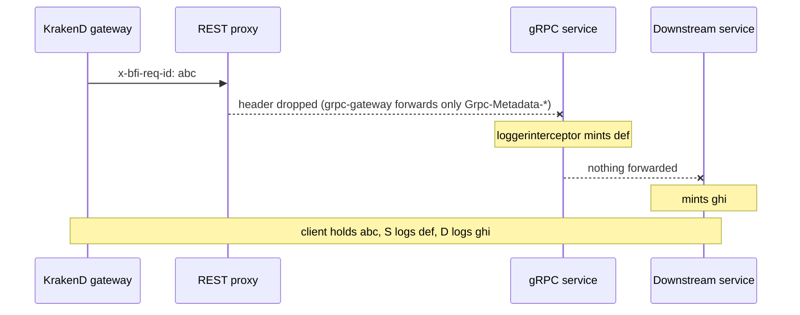
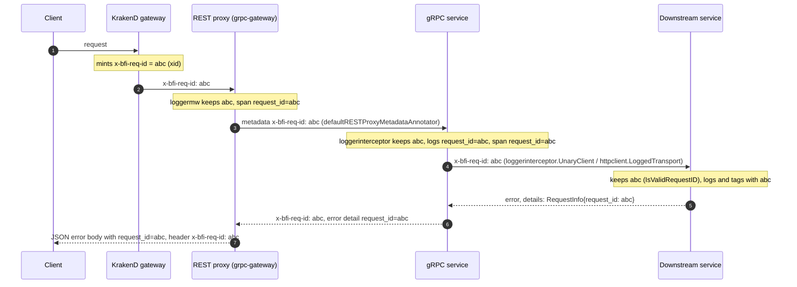
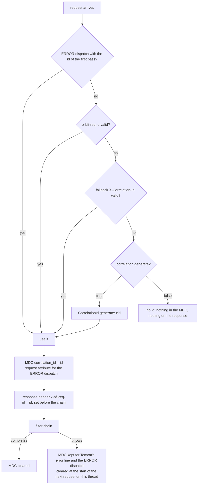
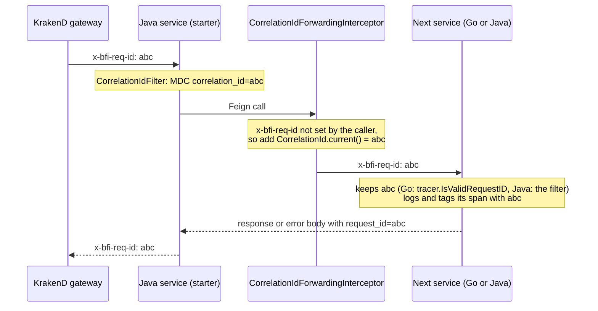

# Log correlation-id, request-id and masking

*Written 16 October 2026. Updated 20 October 2026: the Go pull requests merged, and the masking part and the trace id comparison were added. Covers bfi-go-pkg and bfi-java-pkg (`bfi-logging-core`, `bfi-logging-spring-boot-starter`). Status of every pull request is on [Logging Improvement](README.md).*

## In short

**Request id.** Every request that enters BFI through the API gateway now has **one id**, in the `x-bfi-req-id` header. The gateway makes it. The shared libraries keep it on the way down: each Go and Java service reads it, writes it on every log line, puts it on its Datadog span, returns it to its caller, and sends it on to the next service. When a customer, a partner or a console shows that id, support can find every log line and every span of that request, in every service it touched, with one search. Nobody has to log a request body to do that.

**Masking.** The same libraries now mask request and response bodies by default. Before, masking was a function each service had to wire up, and many never did. Now the library masks every body and query string it logs, using one baseline list of sensitive field names that SRE sets in each service's deployment, plus the service's own additions. Whether bodies are logged at all does not change: that stays off unless a service switches it on.

## Request id, correlation id, trace id

| Name | What it is in BFI |
|---|---|
| **Request id** / **correlation id** | The same thing: the `x-bfi-req-id` value. Go logs it in a field called `request_id`; Java logs it in a field called `correlation_id`. The names differ only because each library had its own name before; the value is the same. |
| **Trace id** | Datadog's own id for a trace. It is not shown to callers. Each service's span carries the request id as the `request_id` tag, so you can go from the id a caller quotes to the trace. |

The id is an [xid](https://github.com/rs/xid): 20 lowercase letters and digits, for example `d3h2k9l5mvbs73b0a1cg`. A service accepts any well-formed id it receives: 1 to 128 letters, digits and `. _ : -`. A malformed one is replaced, so nobody can push a long string or injected text into a field that searches trust.

## Why we need a request id when we already have a trace id

A trace id is for engineers inside Datadog. A request id is a reference that goes wherever the request goes: back to the caller, through the gateway, onto every log line in every log store, into error bodies and into support tickets. The two are joined, because every span carries the request id as the `request_id` tag. We need both.

| | Trace id | Request id (`x-bfi-req-id`) |
|---|---|---|
| Made by | the tracer inside each service: the Datadog agent in Java, OpenTelemetry in Go | the API gateway, once, at the edge |
| Seen by | engineers with Datadog access | the client, a partner, a console user and support: it is in the response header and, where the service opts in, in the error body |
| Exists in | Datadog APM, production only | every log line, in Datadog and in Cloud Logging, in SIT, UAT and production |
| Kept for | a sample of requests: Datadog does not keep every trace | every request: the id is on every log line |
| Survives a change of tracer | only if both sides send the same trace headers | yes: it is one plain header that every hop forwards |
| Best for | timing and errors inside one request: which call was slow, which service failed | finding everything about the request a customer or partner is asking about |

Why this matters at BFI today:

- **SIT and UAT have no traces.** Only the production clusters send data to Datadog. In SIT and UAT the logs are in Cloud Logging and there is no trace at all. A request id works there; a trace id does not.
- **Go and Java use different tracers.** Go services trace with the OpenTelemetry SDK, Java services with the Datadog agent. The trace context has to cross that boundary on every Go to Java call. The request id is one header that both libraries read.
- **Logs were not linked to traces.** On 12 September 2026, a Datadog search for `@dd.trace_id` found no log line in any production service, so nobody could jump from a log line to its trace. Eleven busy services sent no logs to Datadog at all. A request id on the log line works without that link.
- **The caller never sees a trace id.** When a customer, a partner or a console user reports a problem, the only id they can give is the one in the response header or the error body.

## Where the id was lost, and how it travels now

The gateway already made the id before this work. It was lost on the way down, in four places:

1. **Go, REST proxy.** grpc-gateway forwards only a few standard headers to gRPC. No service let `x-bfi-req-id` through, so the gRPC side made a second id. The id the client held was not the id in the logs.
2. **Go, calls to other services.** The library's HTTP and gRPC clients did not send the id on. Every hop started a new one.
3. **Go, incoming id.** The library accepted only an xid, so an id made by a Java service was replaced.
4. **Java.** The filter read `X-Correlation-Id`, but the gateway sends `x-bfi-req-id`, so Java ignored the gateway's id. And when no id arrived, Java made none, so most Java requests had no id at all.

**Before: one request, three different ids.**

<!-- confluence-image: reqid-go-before.png -->

**After: one id from the client to the last service and back, in logs, on spans and in the error body.**

<!-- confluence-image: reqid-go-after-v2.png -->

## What we changed in bfi-go-pkg

Pull request: [bfi-go-pkg#185](https://github.com/bfi-finance/bfi-go-pkg/pull/185), merged on 19 October 2026. A Go service gets all of this by bumping bfi-go-pkg to commit `3026177` or later: `go get github.com/bfi-finance/bfi-go-pkg@3026177`. The few service-side steps are listed after the table.

| Part | What it does now |
|---|---|
| `loggermw` (HTTP server) and `loggerinterceptor` (gRPC server) | Keep a well-formed incoming `x-bfi-req-id` (`tracer.IsValidRequestID`), else make a new xid. Put it on every log line as `request_id`, on the server span as the `request_id` tag, and on the response header. |
| REST proxy (`grpcserver.NewRESTProxy`) | Passes the caller's `x-bfi-req-id` into the gRPC metadata by default, so the gRPC side keeps the gateway's id. |
| HTTP client (`LoggedTransport`, which `httpclient.New` uses) | Sends the current request id on every outgoing call as `x-bfi-req-id`. A header the caller set is kept. A malformed id is not sent. |
| gRPC client (`loggerinterceptor.UnaryClient()`, `StreamClient()`) | Sends the current request id as metadata on outgoing gRPC calls. |
| Error body, opt-in (`errorinterceptor` and `panicinterceptor` with `WithRequestInfoDetail()`; `httpresponse.ErrorAsJSONForRequest` for plain HTTP) | Adds the id to the error as a standard `google.rpc.RequestInfo` detail, so a caller that does not read headers can still quote it. Off by default, because a client with a strict type registry rejects an unknown detail. |
| Errors from another service | The upstream id is kept in the detail as `upstream_request_id=<id>`; `grpcerror.UpstreamRequestIDsFromError` reads it. `httperror.APIError.RequestID()` reads the id from another BFI service's REST error. |
| Rejected requests | The access log line carries `validation_fields` (field name and code, never the value) and `business_code`, so you can search `@validation_fields.field:nik` without logging payloads. |

**What a Go service does after the bump**

- gRPC dials: add `grpc.WithChainUnaryInterceptor(loggerinterceptor.UnaryClient())`. The library cannot add it to a `grpc.NewClient` call for you.
- Error bodies: opt in with `WithRequestInfoDetail()`, or switch plain-HTTP error writers to `httpresponse.ErrorAsJSONForRequest(w, r, err)`.
- Background work (schedulers, queue consumers) has no incoming id and gets none.

## What we changed in bfi-java-pkg

Pull requests: [bfi-java-pkg#129](https://github.com/bfi-finance/bfi-java-pkg/pull/129) and [bfi-java-pkg#132](https://github.com/bfi-finance/bfi-java-pkg/pull/132), both merged (13 and 15 October). It lives in the new libraries only: `bfi-logging-core` and `bfi-logging-spring-boot-starter` (Spring Boot 3.3 or later). The old `bravo-lib-logging` (`logger` module) is deprecated and was not changed.

**`bfi-logging-core`** holds the rules, with no Spring in it, so non-web code uses the same ones:

- `CorrelationId`: the log key (`correlation_id`), the header (`x-bfi-req-id`), the old header (`X-Correlation-Id`), the validity rule, `current()` to read the id, `open(id)` to set it for a block of code, and `generate()` to make one.
- `generate()` makes **xid** ids, the same format as the gateway and Go. That matters: older Go library versions replace any id that is not an xid, so a Java UUID would have broken the chain.

**`bfi-logging-spring-boot-starter`** does the work in a web service:

| Part | What it does |
|---|---|
| `CorrelationIdFilter` | Reads `x-bfi-req-id`, then `X-Correlation-Id` for older callers, else makes an xid. Puts it in the log context and on the response header before the request runs, so even an early rejection returns it. On an exception the id stays for Tomcat's error line and the error page. |
| `CorrelationIdForwardingInterceptor` (Feign) | Sends the id on every outgoing Feign call as `x-bfi-req-id`, so the next service, Go or Java, logs the same id. |
| `ValidationFieldsLogger` | Writes one `request_rejected` line when a request fails bean validation, with field names and codes, never the values. The service's own error handler still writes the response. |
| `CorrelationIdProblemDetailAdvice`, opt-in | Adds `correlation_id` to `ProblemDetail` error bodies. |

Settings, all under `bravo.logging.correlation`:

| Property | Default | Meaning |
|---|---|---|
| `header` | `x-bfi-req-id` | read first, returned, forwarded |
| `fallback-header` | `X-Correlation-Id` | read when `header` is absent; empty turns it off |
| `generate` | `true` | make an id when none arrives |
| `response-header` | `true` | return the id on the response |
| `forward-on-feign` | `true` | send the id on Feign calls |
| `problem-detail` | `false` | add the id to `ProblemDetail` bodies |

**How the Java starter picks the id.**

<!-- confluence-image: reqid-java-filter.png -->

**A Feign call carries the id into the next service.**

<!-- confluence-image: reqid-java-feign.png -->

**What a Java service does**

- Move to the starter. Boot 2.7 services cannot, so they keep `X-Correlation-Id` and a UUID of their own until they move to Boot 3.
- `RestTemplate` and `WebClient` calls are not forwarded by the starter. Add your own interceptor that copies `CorrelationId.current()` into `x-bfi-req-id`.
- Services that set `X-Correlation-Id` in their own code: switch to `x-bfi-req-id`. The starter still reads the old header, so this can be gradual.
- Spans: Java services use the Datadog Java agent, so no code is needed. SRE adds `DD_TRACE_HEADER_TAGS: "x-bfi-req-id:request_id"` to the service's app-deployment values. The tag name matches Go's.

## Go and Java side by side

| | Go (bfi-go-pkg) | Java (starter) |
|---|---|---|
| Header | `x-bfi-req-id` | `x-bfi-req-id` (falls back to `X-Correlation-Id`) |
| Log field | `request_id` | `correlation_id` |
| New id when none arrives | xid | xid |
| Accepted incoming id | 1–128 of letters, digits, `. _ : -` | the same rule |
| Span tag | `request_id`, set in code | `request_id`, through `DD_TRACE_HEADER_TAGS` |
| Returned to the caller | response header; error detail opt-in | response header; `ProblemDetail` opt-in |
| Sent to the next service | HTTP client by default, gRPC client with one line | Feign by default |
| Rejected request | `validation_fields` on the access line | one `request_rejected` line |
| Masking baseline | `DEFAULT_LOG_SENSITIVE_KEYS` | `DEFAULT_LOG_SENSITIVE_KEYS` |
| Service's own mask list | `LOG_SENSITIVE_KEYS`, plus the per-direction `*_BODY_JSON_MASKED_FIELDS` | `LOG_SENSITIVE_KEYS` |
| Masked value shows as | `*****` | `****` |
| Bodies logged by default | no; with body logging on, only on errors | no; `request-logging.include-payload` and `feign.include-body` are `false` |

## How to use it

- **Find every log line of one request:** in Datadog Logs, `@request_id:<id> OR @correlation_id:<id>`.
- **Find its spans:** in Datadog APM, `@request_id:<id>` (once the service runs the new library, and, for Java, has the `DD_TRACE_HEADER_TAGS` setting).
- **Ask the caller for the id:** it is the `x-bfi-req-id` response header, and in the error body where the service opted in.

## Masking request and response bodies

Pull requests: [bfi-go-pkg#186](https://github.com/bfi-finance/bfi-go-pkg/pull/186), merged on 19 October 2026, and [bfi-java-pkg#134](https://github.com/bfi-finance/bfi-java-pkg/pull/134), merged on 15 October and published as core 0.1.4 and starter 0.1.5 on 20 October.

### Why it moved into the libraries

Masking used to be a tool the library offered. Each service had to pass it in, with its own list of fields. About 22 Go services never did, or left the call commented out, so their logged bodies reached Datadog in clear. The old Java library logged bodies by default and matched field names case by case. Now the library masks by itself. A service that forgets its settings still masks.

### How the lists work

| Variable | Who sets it | What it holds |
|---|---|---|
| `DEFAULT_LOG_SENSITIVE_KEYS` | SRE, in every service's manifest | The organisation's baseline: identity numbers, credentials, card and bank numbers, contact details and other personal data. Its value is the organisation's GitHub variable of the same name. |
| `LOG_SENSITIVE_KEYS` | The squad, in its own manifest | Extra field names for this service. Go and Java read the same name. |
| `HTTP_CLIENT_*`, `HTTP_SERVER_*`, `GRPC_SERVER_*` `_REQUEST_BODY_JSON_MASKED_FIELDS` and `_RESPONSE_BODY_JSON_MASKED_FIELDS` | The squad (Go only) | The existing per-direction lists. Values already in app-deployment keep working. |

The rules are the same in both libraries:

- **All lists add up.** A field is masked if any list names it.
- **Names match in any case,** inside nested objects and arrays.
- **There is no built-in list.** A pod without `DEFAULT_LOG_SENSITIVE_KEYS` masks only what its own lists name. This is why the manifest change matters.
- **A service's own masking function runs after the default.** It can mask more fields. It cannot switch the default off.

### What the baseline covers

`DEFAULT_LOG_SENSITIVE_KEYS` holds 83 field names. This is the value in all four manifest pull requests ([app-deployment#14328](https://github.com/bfi-finance/app-deployment/pull/14328), [#14329](https://github.com/bfi-finance/app-deployment/pull/14329), [bfi-app-deployment#4114](https://github.com/bfi-finance/bfi-app-deployment/pull/4114), [#4115](https://github.com/bfi-finance/bfi-app-deployment/pull/4115)), checked on 20 October 2026. The source is the organisation's GitHub variable of the same name; when it changes, SRE copies the new value into the manifests.

| Kind | Names | Field names |
|---|---|---|
| Identity and tax numbers | 13 | `nik`, `ktp`, `ktp_number`, `ktp_data`, `identity_number`, `id_number`, `idnumber`, `legal_id_number`, `spouse_identity_number`, `npwp`, `npwp_number`, `tax_number`, `passport_number` |
| Passwords, keys, tokens and one-time codes | 30 | `password`, `old_password`, `new_password`, `new_password_confirmation`, `secret`, `client_secret`, `client-secret`, `key`, `api_key`, `api-key`, `x-api-key`, `api_secret`, `api-secret`, `access_key`, `accesskey`, `x-auth-app-id`, `x-auth-app-secret`, `token`, `access_token`, `refresh_token`, `id_token`, `x-access-token`, `authorization`, `otp`, `otp_code`, `otp_token`, `pin`, `passphrase`, `signature`, `private_key` |
| Cards and bank accounts | 9 | `cvv`, `cvc`, `cvn`, `card_number`, `account_number`, `account_name`, `bank_account_number`, `bank_account_no`, `bank_account_name` |
| Phone numbers and email | 9 | `phone`, `phone_number`, `mobile_phone`, `mobile_phone_no`, `alternate_phone`, `customer_phone`, `additional_phone_number`, `spouse_phone_number`, `email` |
| Names and personal details | 13 | `full_name`, `spouse_name`, `mother_name`, `mother_maiden_name`, `mothers_maiden_name`, `birth_date`, `dob`, `birth_place`, `pob`, `placeofbirth`, `religion`, `gender`, `salary` |
| Addresses | 4 | `address`, `address_detail`, `legal_address`, `domicile_address` |
| Photos and identity documents | 5 | `selfie`, `selfie_photo_id`, `selfie_doc_id`, `identity_photo_id`, `ktp_doc_id` |

How to read the list:

- **Whole names only, in any case.** `NIK`, `Nik` and `nik` are all masked. `customer_nik` or `nikPemohon` is not, because it is a different name. Add names like these to the service's own `LOG_SENSITIVE_KEYS`.
- **Short names catch more than secrets.** `key`, `token`, `signature` and `pin` are on the list, so any field with exactly that name is masked, even one that holds no secret. If that hides a value you need, log it under a clearer name, for example `idempotency_key`, rather than shorten the list.
- **The list is the same for every service.** To change it for everyone, ask SRE to change the organisation variable. To add names for one service, use `LOG_SENSITIVE_KEYS`.

### What we changed in bfi-go-pkg

| Part | What it does now |
|---|---|
| HTTP server (`requestloggermw`) | Masks the request and response bodies it logs, and the `req_query` and `req_uri` query parameters. |
| HTTP client (`LoggedTransport`) | Masks the outgoing request and response bodies it logs, and the request's query parameters. |
| gRPC server (`requestloggerinterceptor`) | Masks the request and response messages it logs. |
| Your own functions | A function passed to `WithRequestBodyLoggingFunc`, `WithResponseBodyLoggingFunc` or `WithRequestQueryParamLoggingFunc` runs after the default masking. Services that already pass `JSONScrubberFunc` need no change. |
| A data race in `LoggedTransport` | Fixed. Tests that send a request body no longer fail under `go test -race`. |

A masked value shows as `*****`, whatever its type. Bodies are logged only when the service turns body logging on (`WithBodyLogging`), and then only for failed requests unless it also turns off `WithBodyLoggingOnErrorOnly`.

### What we changed in bfi-java-pkg

| Part | What it does now |
|---|---|
| Request bodies (`RequestLoggingFilter`) | Masks the body before logging it. A body over the size limit is skipped with `(over N bytes, not logged)`, not cut short. A cut body is no longer valid JSON, so its fields would escape the mask. |
| Feign calls (`BravoFeignLogger`) | Masks request and response bodies, and the query part of the URL. A body larger than the buffer limit is skipped, not logged. |
| Every log message | A pattern check still masks identity numbers, phone numbers and email addresses written into plain text messages. This was already in 0.1.0. |

A masked value shows as `****`. The old variable `SENSITIVE_KEYS` from `bravo-lib-logging` is not read. Rename it to `LOG_SENSITIVE_KEYS` when the service moves to the starter. In production four manifests use it: agency, lms-ops, onboarding and bfi-incentive-api.

### What a service does

- **SRE** merges the manifest pull requests that add `DEFAULT_LOG_SENSITIVE_KEYS`: SIT and UAT first ([app-deployment#14328](https://github.com/bfi-finance/app-deployment/pull/14328), [bfi-app-deployment#4114](https://github.com/bfi-finance/bfi-app-deployment/pull/4114)), then production after UAT ([app-deployment#14329](https://github.com/bfi-finance/app-deployment/pull/14329), [bfi-app-deployment#4115](https://github.com/bfi-finance/bfi-app-deployment/pull/4115)).
- **Go squads** bump bfi-go-pkg to `3026177` or later. That is the same bump that brings the request id.
- **Java squads** on Spring Boot 3 or 4 adopt starter 0.1.5, and rename `SENSITIVE_KEYS` to `LOG_SENSITIVE_KEYS`.
- **Squads that need more fields masked** add them to `LOG_SENSITIVE_KEYS` in their own manifest. They do not change code.

### How to check it works

- **Check the setting.** The pod's environment must have `DEFAULT_LOG_SENSITIVE_KEYS`. Without it, only the service's own lists apply.
- **Check a logged body.** In SIT, whose logs are in Cloud Logging and not in Datadog, find a logged body that holds a known field such as `nik` or `phone`. Its value shows as `*****` (Go) or `****` (Java).
- **Search for leaks.** In Datadog Logs, search one service for a field that must be masked, for example `service:<name> nik`, and open a few results. The value next to the field name shows as the mask, never the real value.

## Status on 20 October

| Item | Status |
|---|---|
| Java: [#129](https://github.com/bfi-finance/bfi-java-pkg/pull/129), [#132](https://github.com/bfi-finance/bfi-java-pkg/pull/132) | **merged** (and the masking change [#134](https://github.com/bfi-finance/bfi-java-pkg/pull/134) on top) |
| Java packages | core 0.1.4 and starter 0.1.5 **published on 20 October**: the filter, response header and minting from 0.1.3, plus Feign forwarding, the rejected-request line and default masking |
| Java services | `bravo-branch-service` uses the starter on its main branch since 19 October (0.1.2). [bravo-branch-service#525](https://github.com/bfi-finance/bravo-branch-service/pull/525) moves it to 0.1.5 (approved on 20 October, not merged; it must not ship before app-deployment#14328). |
| Go: [#185](https://github.com/bfi-finance/bfi-go-pkg/pull/185) | **merged 19 October** (and the masking change [#186](https://github.com/bfi-finance/bfi-go-pkg/pull/186) on top, merged the same day) |
| Go services | get it by bumping bfi-go-pkg to `3026177` or later; bfi-go-pkg has no release tags. The first three, [lora-gateway-service#1263](https://github.com/bfi-finance/lora-gateway-service/pull/1263), [lora-partnership-ndf#1493](https://github.com/bfi-finance/lora-partnership-ndf/pull/1493) and [lora-partnership-task-ndf#2126](https://github.com/bfi-finance/lora-partnership-task-ndf/pull/2126), are bumped and open. |
| Masking baseline in the manifests | the four pull requests that add `DEFAULT_LOG_SENSITIVE_KEYS` are open: [app-deployment#14328](https://github.com/bfi-finance/app-deployment/pull/14328), [#14329](https://github.com/bfi-finance/app-deployment/pull/14329), [bfi-app-deployment#4114](https://github.com/bfi-finance/bfi-app-deployment/pull/4114), [#4115](https://github.com/bfi-finance/bfi-app-deployment/pull/4115). They wait for SRE review in [SRE-1900](https://bfifinance.atlassian.net/browse/SRE-1900). #14328, #14329 and #4114 conflicted with `master` on 20 October and were updated the same day. |
| SRE | `DD_TRACE_HEADER_TAGS: "x-bfi-req-id:request_id"` for Java services: two draft pull requests, [app-deployment#14453](https://github.com/bfi-finance/app-deployment/pull/14453) (24 services) and [bfi-app-deployment#4146](https://github.com/bfi-finance/bfi-app-deployment/pull/4146) (13 services), opened on 20 October, SRE review in [SRE-1828](https://bfifinance.atlassian.net/browse/SRE-1828) |

The full survey of how each service is wired, and the per-service steps, are on [Logging Improvement](README.md) and the history page.
