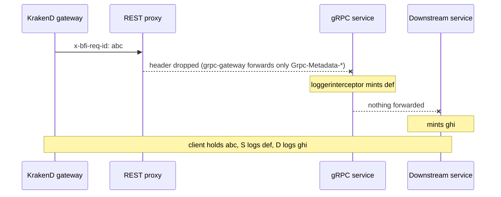
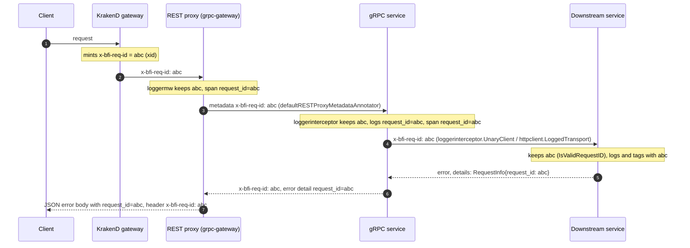
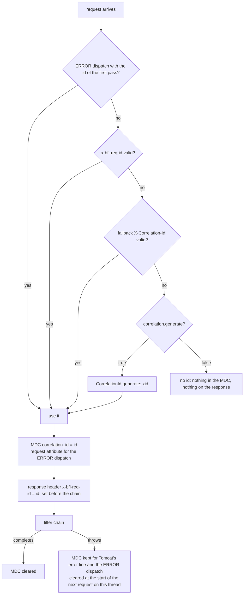
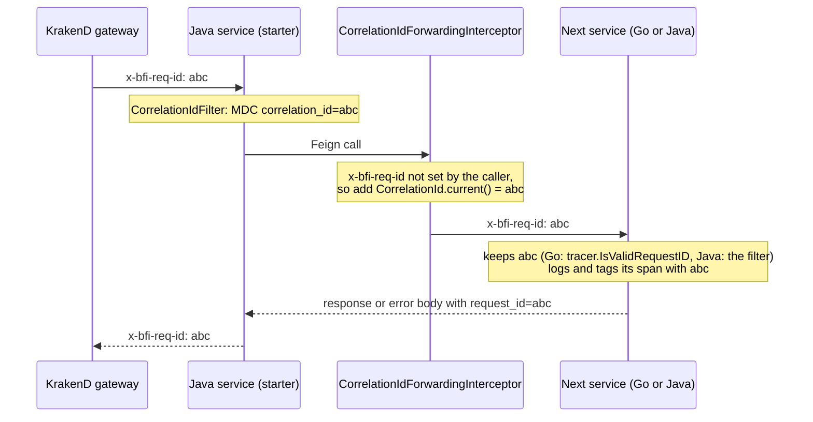

# Log correlation-id and request-id

*Written 16 October 2026, updated 20 October 2026 after the Go pull requests merged. Covers bfi-go-pkg and bfi-java-pkg (`bfi-logging-core`, `bfi-logging-spring-boot-starter`). Status of every pull request is on [Logging Improvement](README.md).*

## In one paragraph

Every request that enters BFI through the API gateway now has **one id**, in the `x-bfi-req-id` header. The gateway makes it. The shared libraries keep it on the way down: each Go and Java service reads it, writes it on every log line, puts it on its Datadog span, returns it to its caller, and sends it on to the next service. When a customer, a partner or a console shows that id, support can find every log line and every span of that request, in every service it touched, with one search. Nobody has to log a request body to do that.

## Request id, correlation id, trace id

| Name | What it is in BFI |
|---|---|
| **Request id** / **correlation id** | The same thing: the `x-bfi-req-id` value. Go logs it in a field called `request_id`; Java logs it in a field called `correlation_id`. The names differ only because each library had its own name before; the value is the same. |
| **Trace id** | Datadog's own id for a trace. It is not shown to callers. Each service's span carries the request id as the `request_id` tag, so you can go from the id a caller quotes to the trace. |

The id is an [xid](https://github.com/rs/xid): 20 lowercase letters and digits, for example `d3h2k9l5mvbs73b0a1cg`. A service accepts any well-formed id it receives: 1 to 128 letters, digits and `. _ : -`. A malformed one is replaced, so nobody can push a long string or injected text into a field that searches trust.

## Where the id was lost, and how it travels now

The gateway already made the id before this work. It was lost on the way down, in four places:

1. **Go, REST proxy.** grpc-gateway forwards only a few standard headers to gRPC. No service let `x-bfi-req-id` through, so the gRPC side made a second id. The id the client held was not the id in the logs.
2. **Go, calls to other services.** The library's HTTP and gRPC clients did not send the id on. Every hop started a new one.
3. **Go, incoming id.** The library accepted only an xid, so an id made by a Java service was replaced.
4. **Java.** The filter read `X-Correlation-Id`, but the gateway sends `x-bfi-req-id`, so Java ignored the gateway's id. And when no id arrived, Java made none, so most Java requests had no id at all.

**Before: one request, three different ids.**

<!-- confluence-image: reqid-go-before.png -->

**After: one id from the client to the last service and back, in logs, on spans and in the error body.**

<!-- confluence-image: reqid-go-after-v2.png -->

## What we changed in bfi-go-pkg

Pull request: [bfi-go-pkg#185](https://github.com/bfi-finance/bfi-go-pkg/pull/185), merged on 19 October 2026. A Go service gets all of this by bumping bfi-go-pkg to commit `3026177` or later: `go get github.com/bfi-finance/bfi-go-pkg@3026177`. The few service-side steps are listed after the table.

| Part | What it does now |
|---|---|
| `loggermw` (HTTP server) and `loggerinterceptor` (gRPC server) | Keep a well-formed incoming `x-bfi-req-id` (`tracer.IsValidRequestID`), else make a new xid. Put it on every log line as `request_id`, on the server span as the `request_id` tag, and on the response header. |
| REST proxy (`grpcserver.NewRESTProxy`) | Passes the caller's `x-bfi-req-id` into the gRPC metadata by default, so the gRPC side keeps the gateway's id. |
| HTTP client (`LoggedTransport`, which `httpclient.New` uses) | Sends the current request id on every outgoing call as `x-bfi-req-id`. A header the caller set is kept. A malformed id is not sent. |
| gRPC client (`loggerinterceptor.UnaryClient()`, `StreamClient()`) | Sends the current request id as metadata on outgoing gRPC calls. |
| Error body, opt-in (`errorinterceptor` and `panicinterceptor` with `WithRequestInfoDetail()`; `httpresponse.ErrorAsJSONForRequest` for plain HTTP) | Adds the id to the error as a standard `google.rpc.RequestInfo` detail, so a caller that does not read headers can still quote it. Off by default, because a client with a strict type registry rejects an unknown detail. |
| Errors from another service | The upstream id is kept in the detail as `upstream_request_id=<id>`; `grpcerror.UpstreamRequestIDsFromError` reads it. `httperror.APIError.RequestID()` reads the id from another BFI service's REST error. |
| Rejected requests | The access log line carries `validation_fields` (field name and code, never the value) and `business_code`, so you can search `@validation_fields.field:nik` without logging payloads. |

**What a Go service does after the bump**

- gRPC dials: add `grpc.WithChainUnaryInterceptor(loggerinterceptor.UnaryClient())`. The library cannot add it to a `grpc.NewClient` call for you.
- Error bodies: opt in with `WithRequestInfoDetail()`, or switch plain-HTTP error writers to `httpresponse.ErrorAsJSONForRequest(w, r, err)`.
- Background work (schedulers, queue consumers) has no incoming id and gets none.

## What we changed in bfi-java-pkg

Pull requests: [bfi-java-pkg#129](https://github.com/bfi-finance/bfi-java-pkg/pull/129) and [bfi-java-pkg#132](https://github.com/bfi-finance/bfi-java-pkg/pull/132), both merged (13 and 15 October). It lives in the new libraries only: `bfi-logging-core` and `bfi-logging-spring-boot-starter` (Spring Boot 3.3 or later). The old `bravo-lib-logging` (`logger` module) is deprecated and was not changed.

**`bfi-logging-core`** holds the rules, with no Spring in it, so non-web code uses the same ones:

- `CorrelationId`: the log key (`correlation_id`), the header (`x-bfi-req-id`), the old header (`X-Correlation-Id`), the validity rule, `current()` to read the id, `open(id)` to set it for a block of code, and `generate()` to make one.
- `generate()` makes **xid** ids, the same format as the gateway and Go. That matters: older Go library versions replace any id that is not an xid, so a Java UUID would have broken the chain.

**`bfi-logging-spring-boot-starter`** does the work in a web service:

| Part | What it does |
|---|---|
| `CorrelationIdFilter` | Reads `x-bfi-req-id`, then `X-Correlation-Id` for older callers, else makes an xid. Puts it in the log context and on the response header before the request runs, so even an early rejection returns it. On an exception the id stays for Tomcat's error line and the error page. |
| `CorrelationIdForwardingInterceptor` (Feign) | Sends the id on every outgoing Feign call as `x-bfi-req-id`, so the next service, Go or Java, logs the same id. |
| `ValidationFieldsLogger` | Writes one `request_rejected` line when a request fails bean validation, with field names and codes, never the values. The service's own error handler still writes the response. |
| `CorrelationIdProblemDetailAdvice`, opt-in | Adds `correlation_id` to `ProblemDetail` error bodies. |

Settings, all under `bravo.logging.correlation`:

| Property | Default | Meaning |
|---|---|---|
| `header` | `x-bfi-req-id` | read first, returned, forwarded |
| `fallback-header` | `X-Correlation-Id` | read when `header` is absent; empty turns it off |
| `generate` | `true` | make an id when none arrives |
| `response-header` | `true` | return the id on the response |
| `forward-on-feign` | `true` | send the id on Feign calls |
| `problem-detail` | `false` | add the id to `ProblemDetail` bodies |

**How the Java starter picks the id.**

<!-- confluence-image: reqid-java-filter.png -->

**A Feign call carries the id into the next service.**

<!-- confluence-image: reqid-java-feign.png -->

**What a Java service does**

- Move to the starter. Boot 2.7 services cannot, so they keep `X-Correlation-Id` and a UUID of their own until they move to Boot 3.
- `RestTemplate` and `WebClient` calls are not forwarded by the starter. Add your own interceptor that copies `CorrelationId.current()` into `x-bfi-req-id`.
- Services that set `X-Correlation-Id` in their own code: switch to `x-bfi-req-id`. The starter still reads the old header, so this can be gradual.
- Spans: Java services use the Datadog Java agent, so no code is needed. SRE adds `DD_TRACE_HEADER_TAGS: "x-bfi-req-id:request_id"` to the service's app-deployment values. The tag name matches Go's.

## Go and Java side by side

| | Go (bfi-go-pkg) | Java (starter) |
|---|---|---|
| Header | `x-bfi-req-id` | `x-bfi-req-id` (falls back to `X-Correlation-Id`) |
| Log field | `request_id` | `correlation_id` |
| New id when none arrives | xid | xid |
| Accepted incoming id | 1–128 of letters, digits, `. _ : -` | the same rule |
| Span tag | `request_id`, set in code | `request_id`, through `DD_TRACE_HEADER_TAGS` |
| Returned to the caller | response header; error detail opt-in | response header; `ProblemDetail` opt-in |
| Sent to the next service | HTTP client by default, gRPC client with one line | Feign by default |
| Rejected request | `validation_fields` on the access line | one `request_rejected` line |

## How to use it

- **Find every log line of one request:** in Datadog Logs, `@request_id:<id> OR @correlation_id:<id>`.
- **Find its spans:** in Datadog APM, `@request_id:<id>` (once the service runs the new library, and, for Java, has the `DD_TRACE_HEADER_TAGS` setting).
- **Ask the caller for the id:** it is the `x-bfi-req-id` response header, and in the error body where the service opted in.

## Status on 20 October

| Item | Status |
|---|---|
| Java: [#129](https://github.com/bfi-finance/bfi-java-pkg/pull/129), [#132](https://github.com/bfi-finance/bfi-java-pkg/pull/132) | **merged** (and the masking change [#134](https://github.com/bfi-finance/bfi-java-pkg/pull/134) on top) |
| Java packages | 0.1.3 published (filter, response header, minting). `master` is now core 0.1.4 / starter 0.1.5 with Feign forwarding, the rejected-request line and default masking; **not published yet**. Platform runs *Deploy Package* for `logging-core`, then `logging-starter`. |
| Java services | none uses the starter on its main branch yet |
| Go: [#185](https://github.com/bfi-finance/bfi-go-pkg/pull/185) | **merged 19 October** (and the masking change [#186](https://github.com/bfi-finance/bfi-go-pkg/pull/186) on top, merged the same day) |
| Go services | get it by bumping bfi-go-pkg to `3026177` or later; bfi-go-pkg has no release tags |
| SRE | `DD_TRACE_HEADER_TAGS: "x-bfi-req-id:request_id"` for Java services: not set yet |

The full survey of how each service is wired, and the per-service steps, are on [Logging Improvement](README.md) and the history page.
